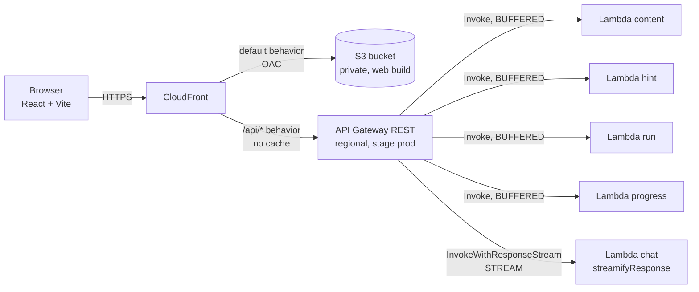
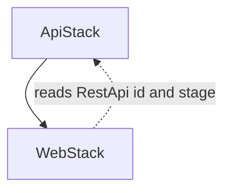
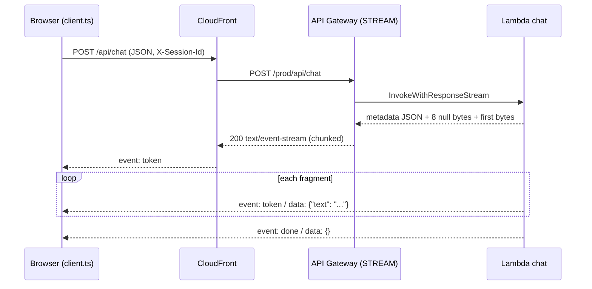
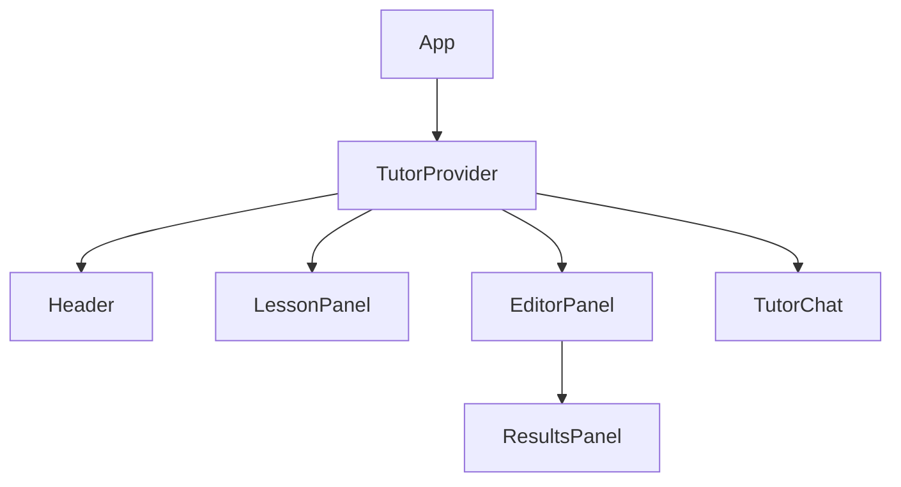

# Design Document

## Overview

Phase 0 builds the full vertical slice of the tutor with fake data: browser, CloudFront, API Gateway REST, Lambdas and a Vite + React front end. Nothing in this phase talks to an agent or a model. The goal is to freeze the API contract and to prove the two risky infrastructure patterns early: streaming through API Gateway REST, and serving the site and the API from one CloudFront origin.

Design goals:
- The contract in `shared/` is final. Phases 1 to 5 change the implementation behind it, not the shape.
- The reference `solution` is loaded only by server code and is never serialized.
- Everything deploys with CDK in TypeScript. Lambdas use `NodejsFunction` with esbuild, with no containers and no Docker.

Out of scope here: agent, Bedrock, AgentCore, real code execution, memory, authentication, the 7 other modules.

## Architecture



Stacks and dependency order:



`WebStack` receives the `RestApi` from `ApiStack` as a prop, so deployment order is `ApiStack` then `WebStack`.

### Chat streaming sequence



### Technical decisions and verified limitations

Verified in the current AWS documentation (API Gateway developer guide, response streaming pages):

| Topic | Finding | Consequence in this design |
|---|---|---|
| Transfer mode | `STREAM` works only with `HTTP_PROXY` or `AWS_PROXY` integrations, REST APIs only | `/api/chat` uses `AWS_PROXY` with `ResponseTransferMode: STREAM` |
| Lambda invocation | API Gateway calls `InvokeWithResponseStream`; the URI ends in `/response-streaming-invocations` (API version `2021-11-15`) | The method integration URI is overridden explicitly |
| Handler output | Metadata JSON, then a delimiter of 8 null bytes within the first 16 KB, then the payload. A function not using this format gets a 500 | Handler uses `awslambda.streamifyResponse` and `HttpResponseStream.from` |
| Mixed modes | A buffered integration with a streamified function returns headers and status but not the body | `chat` and `hint` are **separate Lambdas** even though they share a responsibility (see Decision D1) |
| Timeouts | Stream up to 15 minutes. Idle timeout: 5 minutes regional, 30 seconds edge-optimized | The REST API is `REGIONAL` |
| Unsupported with STREAM | Endpoint caching, content encoding, VTL response transformation, request streaming | No cache on the stage, no compression in the Lambda, request body is read whole |
| Bandwidth | First 10 MB unthrottled, then 2 MB/s | Irrelevant for text chat |
| Disconnects | If the connection closes on timeout, the Lambda may keep running | Lambda timeout is set to cover only the expected duration (30 s in Phase 0) |
| Cost | Response streaming has its own pricing | Mentioned in the README cost section |

**Verified in `us-east-1` (task 16.2):** calling the deployed API Gateway URL directly (not through CloudFront) with `POST /api/chat` returned `200`, `Content-Type: text/event-stream`, and the body arrived incrementally. Measured over 5 runs from a client outside AWS: first `token` at 460 to 690 ms on warm invocations and 1075 ms on one cold start (the cold start is above the 1 s target once, because of the Lambda init time, not buffering). Each run delivered 76 to 77 chunks spaced about 40 ms apart (the mock token delay) over about 3.1 s of streaming, with 78 `token` events and exactly one `done`. `__simulate_error__` produced 3 `token` events and then one `event: error` frame. No Function URL fallback is needed.

**Verified through CloudFront (task 16.3):** `POST https://<distribution>.cloudfront.net/api/chat` returned `200`, `Content-Type: text/event-stream`, `Transfer-Encoding: chunked`, `Cache-Control: no-cache`, no `Content-Encoding` and `X-Cache: Miss from cloudfront`. Over 6 runs from a client outside AWS (Node `fetch` + `ReadableStream`): first byte and first `token` at 291 to 399 ms on warm calls (630 ms on the first call of the session), 77 to 78 chunks with a median gap of 40 ms (p10 39 ms, p90 41 ms, max gap 43 ms on warm runs), about 3.4 s total, 78 `token` events and exactly one `done`. Only the last 3 chunks arrive within the final 100 ms, so there is no end-of-stream burst. `__simulate_error__` produced 3 `token` events and one `event: error` in 235 ms. CloudFront adds no measurable buffering compared with the direct API Gateway numbers (the direct and CloudFront first-token times are in the same range). The other routes also work through CloudFront (`GET /api/modules`, lesson, exercise, `GET /api/progress`, `POST /api/hint`, `POST /api/run`, 400 on an invalid chat body, 404 on an unknown exercise, none with a `solution` key), and `GET /` returns the SPA HTML. In a real browser (Microsoft Edge, headless, driven by Playwright against the SiteUrl) the chat transcript grew in 70 separate DOM updates from 42 to 498 characters over about 3.8 s, with the first growth about 0.9 s after pressing "Enviar" (includes the page's first-request connection setup) and the input re-enabled after `done`. Observation: `GET /favicon.ico` returns 403 (the site has no favicon, and S3 with OAC answers 403 for a missing key); it is harmless and shows only as a console error. The final manual walk-through in a visible browser is part of task 16.4.

## Components and Interfaces

### Repository layout used in Phase 0

```
tutor-agent/
├── package.json              # npm workspaces: shared, web, api, infra
├── package-lock.json
├── shared/                   # @tutor-agent/shared, exports TypeScript source
│   └── src/{index,schemas,content-schema}.ts
├── web/                      # Vite + React + TS
├── api/                      # Lambdas
├── infra/                    # CDK
├── content/modulo-03-condicionales/
├── scripts/                  # empty placeholder in Phase 0 (agent packaging arrives in Phase 1)
└── docs/posts/
```

Dependency versions are pinned exactly in each `package.json` and resolved to the current stable release when the task runs.

### `shared/` contract

`shared/src/schemas.ts` (zod). Fields follow section 6 of `stacky.md`:

```ts
import { z } from 'zod';

export const ModuleSchema = z.object({ id: z.string(), title: z.string(), exerciseCount: z.number().int().nonnegative() });
export const LessonSchema = z.object({ moduleId: z.string(), title: z.string(), markdown: z.string() });

export const ExerciseSchema = z.object({
  id: z.string(), moduleId: z.string(), title: z.string(), statement: z.string(),
  difficulty: z.union([z.literal(1), z.literal(2), z.literal(3)]),
  starterCode: z.string(), hintsAvailable: z.number().int().min(0).max(3),
}); // strict: no solution, hints or tests

export const ChatRequestSchema = z.object({
  sessionId: z.string().min(1).max(128),
  exerciseId: z.string().min(1).max(64),
  message: z.string().trim().min(1).max(2000),
});

export const ChatStreamEventSchema = z.discriminatedUnion('event', [
  z.object({ event: z.literal('token'), data: z.object({ text: z.string() }) }),
  z.object({ event: z.literal('done'), data: z.object({}) }),
  z.object({ event: z.literal('error'), data: z.object({ message: z.string() }) }),
]);

export const HintRequestSchema = z.object({ exerciseId: z.string().min(1).max(64), level: z.union([z.literal(1), z.literal(2), z.literal(3)]) });
export const HintResponseSchema = z.object({ level: z.union([z.literal(1), z.literal(2), z.literal(3)]), text: z.string() });

export const RunRequestSchema = z.object({ exerciseId: z.string().min(1).max(64), code: z.string().max(20_000) });
export const RunResultSchema = z.object({
  passed: z.boolean(),
  tests: z.array(z.object({ name: z.string(), passed: z.boolean(), message: z.string().optional() })),
  stdout: z.string(), stderr: z.string(),
});

export const ProgressSchema = z.object({ completedExerciseIds: z.array(z.string()), totalExercises: z.number().int().nonnegative() });
export const ApiErrorSchema = z.object({ code: z.enum(['invalid_request', 'not_found', 'payload_too_large', 'internal_error']), message: z.string() });
```

The contract has no endpoint that lists the exercises of a module, so `shared/src/ids.ts` exports a helper that derives the ids by convention. Content tests check that the content follows it.

```ts
export function exerciseIdsFor(module: Module): string[] {
  const n = /^modulo-(\d{2})-/.exec(module.id)?.[1];
  return Array.from({ length: module.exerciseCount }, (_, i) => `m${n}-e${String(i + 1).padStart(2, '0')}`);
}
```

`shared/src/content-schema.ts` holds `ExerciseRecordSchema`, the on-disk shape of `ejercicios.json` (includes `prerequisites`, `hints` as a 3-tuple, `tests` with `name`, `call`, `expected`, and `solution`). It is used by server code and by the content validation test only. `web/` imports from the package root, which does **not** re-export `ExerciseRecordSchema`; it is exposed through the subpath `@tutor-agent/shared/content` so that `solution` cannot be pulled into the front end by accident. An ESLint `no-restricted-imports` rule in `web/` forbids that subpath.

`shared` is consumed as TypeScript source (`"exports"` points to `src`). Vite and esbuild both compile it, so there is no separate build step.

### API (`api/`)

| Route | Lambda (entry) | Mode | Notes |
|---|---|---|---|
| `GET /api/modules` | `content` (`src/handlers/content.ts`) | BUFFERED | Routes by `resource` |
| `GET /api/modules/{id}/lesson` | `content` | BUFFERED | |
| `GET /api/exercises/{id}` | `content` | BUFFERED | Public projection only |
| `POST /api/chat` | `chat` (`src/handlers/chat.ts`) | STREAM | `streamifyResponse` |
| `POST /api/hint` | `hint` (`src/handlers/hint.ts`) | BUFFERED | |
| `POST /api/run` | `run` (`src/handlers/run.ts`) | BUFFERED | Never evaluates code |
| `GET /api/progress` | `progress` (`src/handlers/progress.ts`) | BUFFERED | Fixed value |

`src/lib/`:
- `http.ts`: `jsonResponse(status, body, origin)`, `errorResponse(code, message)`, CORS header helper that echoes `Origin` only if it is in `ALLOWED_ORIGINS`.
- `logger.ts`: JSON line logger; `withRequestLogging(handler)` records `sessionId`, `route`, `method`, `status`, `latencyMs`, `requestId`.
- `validate.ts`: `parseBody(schema, event)` enforcing a body size cap of 64 KB and returning a typed result or an `ApiError`.
- `content.ts`: loads the module through esbuild loaders (`.json` native, `.md` as `text`) from `content/`, builds `ModuleRecord[]`, exposes `listModules`, `getLesson`, `getExerciseRecord` and `toPublicExercise`. `toPublicExercise` builds the object field by field (allowlist), it never spreads the record.
- `mock-tutor.ts`: the fixed Spanish Socratic reply, split into word fragments by `fragments()`; the delay between tokens comes from `MOCK_TOKEN_DELAY_MS` (default 40 ms).

Module metadata comes from the content itself: `id` is the folder name, `title` is the first `#` heading of `leccion.md`, `exerciseCount` is the length of `ejercicios.json`. No extra metadata file is needed.

Session identifier: read from the `X-Session-Id` header; for `/api/chat` the body `sessionId` takes precedence. If missing, logs use `"anonymous"`.

Chat handler skeleton:

```ts
export const handler = awslambda.streamifyResponse(async (event, responseStream) => {
  const parsed = parseBody(ChatRequestSchema, event);
  if (!parsed.ok) {
    const out = awslambda.HttpResponseStream.from(responseStream, { statusCode: 400, headers: { 'Content-Type': 'application/json' } });
    out.write(JSON.stringify(parsed.error)); out.end(); return;
  }
  const out = awslambda.HttpResponseStream.from(responseStream, {
    statusCode: 200,
    headers: { 'Content-Type': 'text/event-stream', 'Cache-Control': 'no-cache' },
  });
  // write `event: token\ndata: {...}\n\n` per fragment, then `event: done`
});
```

The message `__simulate_error__` triggers an `event: error` mid-stream so the front end error path can be tested end to end. This trigger is removed in Phase 1.

`/api/run` mock rule: look up the exercise record; if `code.trim() === starterCode.trim()` every test fails with `"Ejecución simulada (Fase 0)"`, otherwise every test passes. Test names come from the record. The code string is only compared, never executed or parsed.

### Local development

`api/src/local/dev-server.ts` (run with `tsx`) is a small `node:http` adapter that builds API Gateway proxy events and calls the handlers. For the chat handler it installs a minimal `awslambda` global (`streamifyResponse` as identity, `HttpResponseStream.from` writing status and headers on the Node response). Vite proxies `/api` to `http://localhost:3001`, so local and deployed behavior are both same-origin and `VITE_API_URL` stays empty.

### Front end (`web/`)

Styling decision **D2 (confirmed): CSS Modules.** Reason: no extra build configuration, no new dependency, easy to explain in the post, and enough for a three-panel layout. Tailwind remains valid but would add configuration to the article. `tech.md` records this decision.



| Unit | Responsibility |
|---|---|
| `api/client.ts` | `getModules`, `getLesson`, `getExercise`, `postHint`, `postRun`, `getProgress`, `streamChat(req, handlers, signal)`. Adds `X-Session-Id`, builds URLs from `VITE_API_URL`, validates with `shared` schemas, throws `ApiClientError` |
| `api/sse.ts` | Pure SSE parser over a `ReadableStream<Uint8Array>`; handles frames split across chunks and multi-line `data:` |
| `hooks/useExercise` | Loads modules, lesson and exercises; selected exercise; local `completedIds` |
| `hooks/useChat` | Messages, `streaming` flag, `send`, `cancel`, hint insertion |
| `hooks/useRunCode` | `run(code)`, `running`, `result`, `error` |
| `components/Header` | Project name and module title |
| `components/LessonPanel` | Markdown lesson (`react-markdown`, raw HTML not enabled), exercise tabs, statement and difficulty |
| `components/EditorPanel` | Monaco (Python), "Ejecutar", three hint buttons, keyboard hint text |
| `components/ResultsPanel` | Test list, `stdout`, `stderr`, success message |
| `components/TutorChat` | Transcript in an `aria-live="polite"` region, input, send and cancel |

State lives in one `TutorProvider` (Context + hooks). No global state library.

Hint flow: hint buttons live in `EditorPanel`. The hint text is appended to the chat transcript as a tutor message labelled "Pista N", so the student sees hints and conversation in one place. The level N button is enabled only when `hintsUsed >= N - 1` for the current exercise.

Monaco note: `@monaco-editor/react` loads Monaco from a CDN by default. Phase 0 keeps the default and records it as a limitation (third-party request, offline use); bundling `monaco-editor` locally is a candidate improvement for Phase 5.

Accessibility specifics: `<main>` wraps three `<section aria-label>` regions; visible `:focus-visible` outline; the editor shows the line "Esc y luego Tab para salir del editor"; palette chosen for 4.5:1 contrast.

### Infrastructure (`infra/`)

`bin/app.ts` reads context from `cdk.json`:

```json
{
  "app": "npx ts-node --prefer-ts-exts bin/app.ts",
  "context": {
    "projectName": "tutor-agent",
    "phase": "0",
    "region": "us-east-1",
    "allowedOrigins": ["http://localhost:5173"]
  }
}
```

Region **D5 (confirmed): `us-east-1`**, because it has the widest availability of AgentCore and Bedrock models, which Phase 1 needs. REST streaming availability in that region was verified in task 16.2.

`Tags.of(app)` adds `Project` and `Phase` to every resource.

`ApiStack`:
- `RestApi` with `EndpointType.REGIONAL`, stage `prod`, `throttlingRateLimit: 50`, `throttlingBurstLimit: 100`, JSON access logs to a CloudWatch log group with 1-month retention, `cloudWatchRole` for logging, no cache cluster.
- Resources: `/api/modules`, `/api/modules/{id}/lesson`, `/api/exercises/{id}`, `/api/chat`, `/api/hint`, `/api/run`, `/api/progress`.
- Five `NodejsFunction` constructs: `runtime: NODEJS_22_X`, `architecture: ARM_64`, `memorySize: 256` (chat: 256), `timeout: 10 s` (chat: 30 s), `depsLockFilePath` at the root lockfile, `projectRoot` at the repo root, bundling `{ minify: true, sourceMap: true, target: 'node22', format: OutputFormat.ESM, loader: { '.md': 'text' } }`, esbuild resolved locally from `infra/devDependencies`. Each has its own role with only `AWSLambdaBasicExecutionRole` (log group) and no other policy.
- `chat` method: created with `LambdaIntegration` for the invoke permission, then `CfnMethod` property overrides: `Integration.ResponseTransferMode = 'STREAM'`, `Integration.Uri = arn:aws:apigateway:{region}:lambda:path/2021-11-15/functions/{fnArn}/response-streaming-invocations`, `Integration.TimeoutInMillis = 60000`. The `AWS::Lambda::Permission` generated by the L2 integration already allows `apigateway.amazonaws.com` to invoke; the IAM action for streaming (`lambda:InvokeFunction` on the function) is covered by it. This is checked in the CDK test and in task 16.2.
- Request validation: a `RequestValidator` with `validateRequestParameters` and `validateRequestBody`, and minimal JSON models (object type) on POST methods. Exact schema validation is done by zod in the Lambda; deriving API Gateway models from the zod schemas is a possible follow-up.
- CORS: `defaultCorsPreflightOptions` with `allowOrigins` from context, methods `GET, POST, OPTIONS`, headers `Content-Type, X-Session-Id`.
- Outputs: `ApiUrl`, `ApiId`, one ARN per function.

`WebStack`:
- `Bucket`: `BLOCK_ALL`, `enforceSSL`, `S3_MANAGED` encryption, `RemovalPolicy.DESTROY` with `autoDeleteObjects` (acceptable for a POC; revisit in Phase 5).
- `Distribution`: default behavior `S3BucketOrigin.withOriginAccessControl(bucket)`, `defaultRootObject: 'index.html'`, `viewerProtocolPolicy: REDIRECT_TO_HTTPS`, `SECURITY_HEADERS` response policy.
- Behavior `/api/*`: `HttpOrigin('{restApiId}.execute-api.{region}.amazonaws.com', { originPath: '/prod', readTimeout: 60 s })`, `allowedMethods: ALLOW_ALL`, `cachePolicy: CACHING_DISABLED`, `originRequestPolicy: ALL_VIEWER_EXCEPT_HOST_HEADER`, `compress: false`.
- No custom error responses. A catch-all rewrite of 403/404 to `index.html` would also rewrite API errors, because CloudFront error responses apply to the whole distribution. The app has a single page and no client routes, so no rewrite is needed.
- `BucketDeployment` publishes `web/dist` (path from context `webDistPath`, default `../web/dist`) and invalidates `/*`. It is backed by a CDK-managed singleton Lambda, not a container.
- Outputs: `SiteUrl`, `DistributionId`, `BucketName`.

CORS note: in the deployed site the browser calls `/api/*` on the CloudFront domain, which is same-origin, so CORS is not exercised. CORS configuration still exists for local direct calls and for later custom domains. Because of that there is no circular dependency between the CloudFront domain and the API CORS list.

Security note: the API Gateway invoke URL stays reachable directly. That is acceptable because the API is public in Phase 0. Phase 5 adds the Cognito authorizer.

## Data Models

On-disk exercise record (`content/modulo-03-condicionales/ejercicios.json`, an array):

```json
{
  "id": "m03-e01",
  "moduleId": "modulo-03-condicionales",
  "title": "Clasifica edades",
  "statement": "...",
  "difficulty": 1,
  "prerequisites": ["modulo-02"],
  "starterCode": "def clasificar(edad):\n    pass\n",
  "hints": ["nivel 1", "nivel 2", "nivel 3"],
  "tests": [{ "name": "menor de edad", "call": "clasificar(15)", "expected": "menor" }],
  "solution": "def clasificar(edad):\n    ..."
}
```

Planned exercises: `m03-e01` classify ages (difficulty 1, `if/else`), `m03-e02` sign of a number (difficulty 2, `if/elif/else`), `m03-e03` letter grade from a score (difficulty 3, chained conditions and boundaries). Each has at least 3 tests that include a boundary case.

The public `Exercise` is derived: `hintsAvailable = hints.length`; `hints`, `tests`, `solution`, `prerequisites` are dropped.

## Correctness Properties

*A property is a characteristic that must hold for every valid execution of the system. The properties below are the executable specification that the tests in the Testing Strategy check, with property-based tests where the input space is large.*

### Property 1: The solution is never serialized

*For any* endpoint, any request (valid or invalid) and any exercise, the response body, including SSE output and error bodies, contains neither a `solution` key nor the text of any exercise solution.

**Validates: Requirements 2.4, 7.6, 9.5, 10.6**

### Property 2: Responses conform to the shared contract

*For any* valid request to any of the seven endpoints, the response body parses successfully with the matching schema from `shared/`.

**Validates: Requirements 2.1, 9.1, 9.2**

### Property 3: Invalid chat input never opens a stream

*For any* `/api/chat` body that does not satisfy `ChatRequest`, the response is a 400 JSON `ApiError` and no `text/event-stream` content is produced.

**Validates: Requirements 6.8, 9.3**

### Property 4: SSE streams are well formed

*For any* accepted chat request, the stream is zero or more `token` events followed by exactly one terminal event (`done` or `error`), and no event follows the terminal one.

**Validates: Requirements 6.1, 6.2, 6.9**

### Property 5: The SSE parser is invariant to chunking

*For any* SSE byte stream and any way of splitting it into chunks, the parser emits the same sequence of events.

**Validates: Requirements 6.1, 8.6**

### Property 6: The simulated run depends only on whether the code changed

*For any* exercise and any code string, the `RunResult` lists the exercise tests in content order, every test has the same outcome, the outcome is failed exactly when the code equals the starter code, and the code is never evaluated.

**Validates: Requirements 5.5, 5.6, 5.7**

### Property 7: Hints return the authored text of the requested level

*For any* existing exercise and any level in 1 to 3, `/api/hint` returns that level and the hint text stored in the content; *for any* other level or unknown exercise it returns 400 or 404.

**Validates: Requirements 7.4, 7.5**

### Property 8: Exercise ids follow the convention

*For any* module served by the API, every id returned by `exerciseIdsFor(module)` resolves to an exercise of that module, and the number of ids equals `exerciseCount`.

**Validates: Requirements 2.7, 2.8, 10.3**

### Property 9: Every log line carries a session identifier

*For any* request, the structured log line includes `sessionId` (or `anonymous`), route, method, status and latency.

**Validates: Requirements 9.7**

## Error Handling

| Case | Status | Body |
|---|---|---|
| Body is not valid JSON, fails zod, or `level` out of range | 400 | `ApiError` `invalid_request` |
| Body larger than 64 KB | 413 | `ApiError` `payload_too_large` |
| Module or exercise not found | 404 | `ApiError` `not_found` |
| Unexpected exception | 500 | `ApiError` `internal_error`, generic message; the stack goes to the log only |
| Failure after the stream started | n/a | `event: error` frame, then the stream ends |

The front end maps: network failure or 5xx to a Spanish retry message, 4xx to a short validation message, `event: error` to the chat error state. SSE parse errors close the stream and show the same chat error state.

## Testing Strategy

| Layer | Tool | Coverage |
|---|---|---|
| `shared` | Vitest | Schemas accept valid samples; `ExerciseSchema` rejects extra `solution` keys when parsed strictly; content test validates `ejercicios.json` against `ExerciseRecordSchema` |
| `api` | Vitest | Each handler against the `shared` schemas; a recursive scan asserts that no response (including SSE output and error bodies) contains the `solution` keys or the solution text of any exercise; SSE framing; 400/404/413 cases; log line contains `sessionId` |
| `web` | Vitest + React Testing Library | `client.ts` (URLs, headers, schema failure), `sse.ts` (split chunks, multi-line data, `error`), hint button enabling order, run button disabled while running, results panel rendering, chat append and cancel |
| `infra` | Jest + CDK assertions | Runtime `nodejs22.x`, `arm64`, five functions, `ResponseTransferMode` `STREAM` only on `/api/chat`, URI suffix, tags, bucket public access block, `/api/*` behavior with caching disabled, no `bedrock:*` or `bedrock-agentcore:*` in any policy |
| Manual E2E | Browser | Open module, chat, three hints in order, run failing and passing code, cancel a reply, `__simulate_error__` |

CDK tests use Jest because `stacky.md` section 11 specifies it for the infra layer; `web/` and `api/` use Vitest as in the steering. Infra tests pass `webDistPath` pointing to a small fixture directory so they do not depend on a built front end.

## Open decisions and status

| # | Decision | Status in this design |
|---|---|---|
| 1 | Project name and `.dev` domain | Open. `tutor-agent` is used as working name |
| 2 | Styling | **CSS Modules, confirmed by the user (D2).** Recorded in `tech.md` |
| 3 | Progress persistence | Not applicable in Phase 0 (fixed `Progress`). Decided in Phase 3 |
| 4 | Streaming through API Gateway REST | **Verified and closed.** Verified in `us-east-1` (task 16.2):** direct call to API Gateway streams incrementally, first `token` 460 to 690 ms warm (1075 ms cold start). Fallback (Function URL with `RESPONSE_STREAM`) not needed. **CloudFront pass-through verified (task 16.3):** through the `/api/*` behavior the first `token` arrives at 291 to 399 ms warm and 78 tokens arrive spaced about 40 ms (no burst, no `Content-Encoding`); the transcript also grows progressively in a headless Edge browser |
| 4b | One Lambda per responsibility | **Five functions, confirmed by the user (D1).** `chat` is streamified and `hint` is buffered, and API Gateway does not support a streamified function behind a buffered integration, so they cannot share a function. Both share `lib/` and have identical IAM. `tech.md` records the split |
| 5 | Region | **`us-east-1`, confirmed by the user (D5)** |
| 6 | OpenAPI from zod | Skipped in Phase 0 |
| 7 | Auth toward the agent | Not applicable in Phase 0 |

Known Phase 0 limitations: the API is public and unauthenticated; code is never executed; Monaco loads from a CDN; the mock tutor does not react to the message content.
