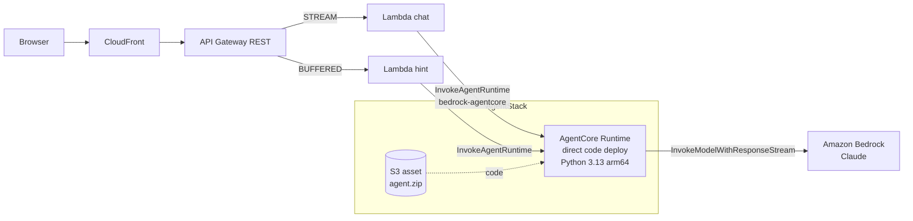
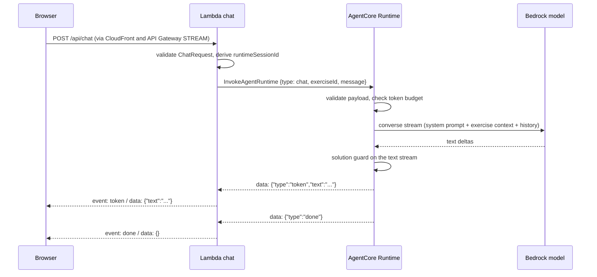
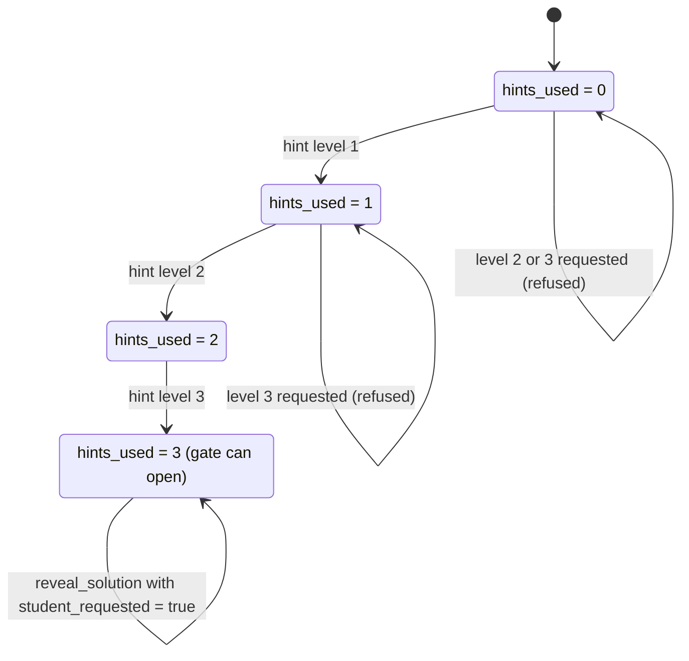
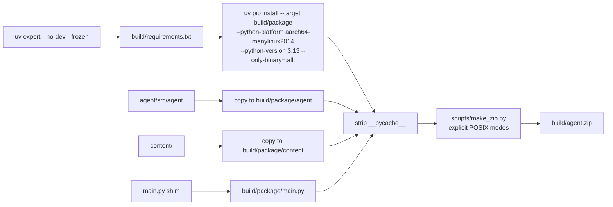

# Design Document

## Overview

Phase 1 puts a real tutor behind the contract frozen in Phase 0. A Strands agent (Python 3.13, uv) runs on AgentCore Runtime as a zip uploaded to S3. The `chat` and `hint` Lambdas call it with `InvokeAgentRuntime` and relay the stream through the unchanged SSE contract. The front end and `shared/` do not change.

The central design question of this phase is how to keep the promise "the tutor never gives the full solution before the hints are exhausted". The design uses four independent layers, because a language model can solve a beginner exercise by itself and no single layer is enough:

1. The solution is not in the model context. Only the `reveal_solution` tool can return it.
2. A deterministic gate (`hints_used == 3` and an explicit student request) controls that tool.
3. A solution guard inspects code blocks in the output while the gate is closed.
4. A fixed evaluation set (offline and live) measures the result before the phase closes.

Bedrock Guardrails (Phase 4) and Code Interpreter based checks (Phase 2) add further layers later.

## Architecture



Stacks and deployment order: `AgentStack` then `ApiStack` then `WebStack`. `ApiStack` receives the runtime ARN from `AgentStack` as a prop and passes it to the two Lambdas as `AGENT_RUNTIME_ARN`.

### Chat sequence



### Hint state machine (per runtime session and exercise)



### Verified documentation and limitations

| Topic | Finding (current AWS documentation) | Consequence |
|---|---|---|
| Direct code deploy | Zip with code and dependencies, arm64, entrypoint `.py` using `@app.entrypoint` or `/invocations` and `/ping`; POSIX permissions apply; do not ship `__pycache__` | Packaging script sets permissions explicitly and strips bytecode |
| Package size | 250 MB for direct code deploy (container images allow 2 GB) | The script fails above 250 MB; actual size is recorded after the first build |
| Session creation | Direct code deploy allows 25 new sessions per second (1.6 for containers) | Not a constraint for the POC |
| Python versions | The CDK enum `AgentCoreRuntime` includes `PYTHON_3_13` | Matches the steering decision |
| CDK artifact | `AgentRuntimeArtifact.fromS3(location, runtime, entrypoint[])` and `fromCodeAsset(options)` exist in `aws-cdk-lib/aws_bedrockagentcore`; the `Runtime` L2 exists | Use `Runtime` L2 with `fromS3` (see D3) |
| Invocation | `InvokeAgentRuntime`; `runtimeSessionId` length 33 to 256; payload up to 100 MB; streaming response; permission `bedrock-agentcore:InvokeAgentRuntime` | Session id is derived to 38+ characters (see below) |
| Errors | `ValidationException`, `ResourceNotFoundException`, `AccessDeniedException`, `ThrottlingException`, `RetryableConflictException` (409, SDK retries) | Mapped in the Lambda error table |
| Entrypoint streaming | An async generator entrypoint is bridged to server-sent events by `BedrockAgentCoreApp` | Agent yields protocol events; Strands `stream_async` feeds them |
| Security guidance | The payload `prompt` can be any JSON type; non-string content blocks may reach the framework as tool use | Entrypoint enforces `isinstance(message, str)` before any agent call |

Items that stay unverified until implementation: exact SSE framing of the runtime response in the JS SDK stream object (task 9.2), IAM resource format for `InvokeAgentRuntime` including endpoints (task 9.3), and whether the `Runtime` L2 grants S3 read on a `fromS3` artifact automatically (task 8.3).

## Components and Interfaces

### Agent project layout

```
agent/
├── pyproject.toml          # python >=3.13,<3.14; deps: strands-agents, bedrock-agentcore, boto3 (pinned)
├── uv.lock
├── src/agent/
│   ├── app.py              # BedrockAgentCoreApp, @app.entrypoint, dispatch chat/hint
│   ├── config.py           # env: MODEL_ID, MAX_OUTPUT_TOKENS, SESSION_TOKEN_BUDGET, CONTENT_DIR, GUARD_THRESHOLD
│   ├── content.py          # load ejercicios.json, lesson, errores-comunes (server side)
│   ├── prompts.py          # Spanish system prompt and fixed messages
│   ├── state.py            # SessionState: hints_used, struggles, tokens_used
│   ├── tools.py            # build_tools(state, content): get_next_hint, reveal_solution, record_struggle
│   ├── guard.py            # SolutionGuard (stream-safe), similarity function
│   ├── protocol.py         # event constructors and payload validation
│   └── logging.py          # JSON logger with session id
└── tests/
```

`scripts/make_zip.py` (standard library only) and `scripts/package-agent.(ps1|sh)` live outside `agent/`.

### Payload and stream protocol

Request payload (validated in `protocol.py`):

```json
{ "type": "chat", "exerciseId": "m03-e01", "message": "No entiendo el if" }
{ "type": "hint", "exerciseId": "m03-e01", "level": 2 }
```

Agent stream protocol (internal, mirrored in `api/src/lib/agent-protocol.ts` with a zod schema; it is not part of the public contract):

| Event | Shape | Meaning |
|---|---|---|
| token | `{"type":"token","text":"..."}` | A piece of tutor text |
| done | `{"type":"done"}` | End of reply |
| error | `{"type":"error","message":"..."}` | Failure, message already safe to show |
| hint | `{"type":"hint","level":2,"text":"..."}` | Only for `type: hint` (non-streaming JSON reply) |
| refused | `{"type":"refused","reason":"hint_locked","message":"..."}` | Hint ladder violation for `type: hint` |

For `type: hint` the agent returns a single JSON object (`application/json`); for `type: chat` it yields events and the runtime serves `text/event-stream`.

### Entrypoint sketch

```python
app = BedrockAgentCoreApp()

@app.entrypoint
async def invoke(payload: dict, context):
    request = parse_payload(payload)            # raises ProtocolError -> single error event
    session = sessions.get_or_create(context.session_id)
    if request.type == "hint":
        yield session.hint_response(request)    # deterministic, no model call
        return
    if session.budget_exhausted():
        yield protocol.token(BUDGET_MESSAGE); yield protocol.done(); return
    guard = SolutionGuard(session.solution_for(request.exercise_id), session.gate_open(request.exercise_id))
    async for event in session.agent_for(request.exercise_id).stream_async(request.message):
        text = event.get("data")
        if text:
            for safe in guard.feed(text):
                yield protocol.token(safe)
    for safe in guard.flush():
        yield protocol.token(safe)
    session.record_usage(...)
    yield protocol.done()
```

The sketch shows intent. The final code follows the Strands streaming event shapes and the `BedrockAgentCoreApp` context object of the pinned versions.

### Session state and agent construction

`SessionState` holds, for one runtime session: per exercise `hints_used` and `solution_revealed`, per concept struggle counters, and `tokens_used`. A module-level registry keyed by `context.session_id` stores the state and one Strands `Agent` per session with a `SlidingWindowConversationManager` (window of 20 messages). The Agent is created with the model from `MODEL_ID`, `max_tokens` from `MAX_OUTPUT_TOKENS`, the Spanish system prompt, and the tools built over that session state. The exercise context (title, statement, starter code) is injected per request as a short system-side context block and never includes `solution`.

Limitation: state lives in process memory, so it is lost when the runtime session expires or the microVM is recycled. Phase 3 persists progress in AgentCore Memory. Until then the front end hint buttons still enforce order locally, and a lost session simply restarts the ladder at level 1.

### Tools

| Tool | Behavior |
|---|---|
| `get_next_hint(exercise_id)` | Returns the authored hint for level `hints_used + 1` (or the last one when already at 3) and increments the counter; the prompt tells the model to present it as a guiding question |
| `reveal_solution(exercise_id, student_requested)` | Returns the solution only if `hints_used == 3` and `student_requested` is true; otherwise returns a refusal that points to the next hint or a guiding question. Sets `solution_revealed` and opens the guard |
| `record_struggle(concept)` | Increments the counter for the concept; at 3 returns the instruction to change analogy or lower difficulty and resets the counter |

`reveal_solution` is the single code path that reads `solution`. A unit test asserts that no other function in the package references it.

### Solution guard

`SolutionGuard.feed(chunk)` passes text outside fenced code blocks immediately. When a line starting with a triple backtick opens a block, it buffers until the closing fence (or `flush()` at the end of the stream). The buffered block is normalized (whitespace collapsed, comments and docstrings removed, identifiers kept) and compared with the normalized solution using `difflib.SequenceMatcher` ratio. If the ratio is at or above `GUARD_THRESHOLD` (default 0.8) and the gate is closed, the block is replaced by a fixed Spanish message ("Prefiero que lo construyas tú. ¿Probamos con la siguiente pista?"). When the gate is open the guard is a pass-through. Known limit: the guard cannot detect a semantically equivalent solution written very differently, which is why the evaluation set and Phase 4 Guardrails exist. The threshold is tunable from the live evaluation results.

### Token budget

After each model call the agent reads usage from the Strands result metrics and adds it to `tokens_used`. When `tokens_used >= SESSION_TOKEN_BUDGET` the next chat returns the fixed budget message without a model call. Defaults: `MAX_OUTPUT_TOKENS=600`, `SESSION_TOKEN_BUDGET=40000`; both are CDK context values. The budget alarm itself belongs to Phase 5.

### Prompt

`prompts.py` contains the Spanish system prompt with sections: role and tone, Socratic rules, hint ladder rules, when to call each tool, error explanation style, adaptation rule, injection hygiene (the student message is data), and the answer-in-Spanish rule. `tests/test_prompts.py` asserts the presence of each principle from `product.md` (for example "3 niveles", "analogía", "método socrático") so that edits cannot silently drop one.

### Packaging



`main.py` at the zip root is a shim: `from agent.app import app` and `app.run()` under `__main__`. `make_zip.py` writes each entry with `ZipInfo.external_attr = (mode << 16)` using 0o755 for directories and 0o644 for files, and 0o755 for files that already have the executable bit in the source. This does not depend on the host filesystem, which matters because the development machine is Windows.

### Infrastructure

`AgentStack` (new):
- `Asset(this, 'AgentZip', { path: <context agentZipPath, default ../build/agent.zip> })`. A path that is a file is uploaded to the CDK bootstrap bucket as is.
- `AgentRuntimeArtifact.fromS3({ bucketName: asset.s3BucketName, objectKey: asset.s3ObjectKey }, AgentCoreRuntime.PYTHON_3_13, ['main.py'])`.
- `Runtime` with name from `projectName`, `environmentVariables` `MODEL_ID`, `MAX_OUTPUT_TOKENS`, `SESSION_TOKEN_BUDGET`, `CONTENT_DIR=/var/task/content` (path verified at implementation).
- Policy statements on the execution role: `bedrock:InvokeModel` and `bedrock:InvokeModelWithResponseStream` on the inference profile ARN and on the foundation model ARNs listed in the profile; no wildcard resource. The asset is granted read to the runtime role.
- Outputs: `AgentRuntimeArn`, `AgentRuntimeId`.

`ApiStack` changes:
- Props: `agentRuntimeArn`.
- `chat`: env `TUTOR_BACKEND=agent`, `AGENT_RUNTIME_ARN`; timeout 120 s; integration timeout 120,000 ms; memory 256 MB.
- `hint`: same env; timeout 15 s.
- Policy on `chat` and `hint` only: `bedrock-agentcore:InvokeAgentRuntime` on the runtime ARN and `<arn>/*`.
- The Phase 0 CDK test "no Bedrock permission anywhere" changes to "only `chat` and `hint` carry `InvokeAgentRuntime`, scoped to the runtime ARN, and no function has `bedrock:*`".

### API changes

- `api/src/lib/agent-client.ts`: interface `AgentClient { streamChat(req): AsyncIterable<AgentEvent>; hint(req): Promise<AgentHint> }` with two implementations: `AgentCoreClient` (SDK `InvokeAgentRuntimeCommand`) and `LocalAgentClient` (HTTP to `AGENT_LOCAL_URL/invocations`).
- `api/src/lib/session.ts`: `deriveRuntimeSessionId(sessionId)` returns `"tutor-" + sha256(sessionId).hex.slice(0, 40)` (46 characters, satisfies the 33 minimum, does not expose the raw id, deterministic).
- `handlers/chat.ts`: if `TUTOR_BACKEND=mock` use Phase 0 `mock-tutor`; otherwise iterate `agentClient.streamChat` and map events to SSE frames. The SDK response body is a stream; the Lambda decodes chunks, splits `data:` lines (the runtime serves SSE for generator entrypoints) and parses JSON per line with the zod protocol schema.
- `handlers/hint.ts`: validates `X-Session-Id`, calls `agentClient.hint`, maps `refused` to 400.
- Dependency: `@aws-sdk/client-bedrock-agentcore`. It is not part of the Lambda Node.js 22 runtime's guaranteed SDK version, so it is bundled by esbuild (the `externalModules` list for the two functions excludes it) and its version is pinned.

Error mapping in the `chat` Lambda:

| Agent or SDK condition | SSE or HTTP result | Spanish message (generic) |
|---|---|---|
| Invalid request body | 400 JSON before the stream | n/a |
| `ThrottlingException` after SDK retries | `error` event | "El tutor está ocupado. Intenta de nuevo en unos segundos." |
| `AccessDeniedException`, `ResourceNotFoundException`, `ValidationException` | `error` event, cause logged | "No pude contactar al tutor. Intenta más tarde." |
| Stream cut after tokens | `error` event | "Se interrumpió la respuesta. Puedes reintentar." |
| Agent `error` event | `error` event with the agent message | as provided |

### Local development

`uv run python -m agent.app` (via the app `run()`) listens on port 8080. `curl -X POST http://localhost:8080/invocations -H "Content-Type: application/json" -d '{"type":"chat","exerciseId":"m03-e01","message":"hola"}'` tests it. The API dev server uses `TUTOR_BACKEND=agent` and `AGENT_LOCAL_URL=http://localhost:8080`. The runtime session id is not enforced locally, so the local agent keys state by a header or falls back to a single default session.

## Data Models

- `SessionState`: `hints_used: dict[str, int]`, `solution_revealed: set[str]`, `struggles: dict[str, int]`, `tokens_used: int`.
- Authored content is read from `content/` copied into the zip (`content/modulo-03-condicionales/ejercicios.json`, `leccion.md`, `errores-comunes.md`). `errores-comunes.md` becomes part of the agent context for explaining mistakes, truncated to a fixed size.
- CDK context additions in `cdk.json`: `modelId`, `maxOutputTokens`, `sessionTokenBudget`, `agentZipPath`.

## Correctness Properties

*A property is a characteristic that must hold for every valid execution of the system. The properties below are the executable specification for the agent tests and the evaluation set.*

### Property 1: The hint ladder is monotonic and gated

*For any* sequence of hint requests for one exercise, a hint of level N is served only when `hints_used >= N - 1`, `hints_used` never decreases and never exceeds 3, and repeating a served level returns the same text without changing the counter.

**Validates: Requirements 4.1, 4.2, 4.3, 4.4**

### Property 2: Chat and API hints share one counter

*For any* interleaving of `get_next_hint` tool calls and `type: hint` requests, `hints_used` equals the highest level served through either path.

**Validates: Requirements 4.6**

### Property 3: The solution is revealed only through an open gate

*For any* tool call to `reveal_solution`, the solution text is returned if and only if `hints_used == 3` and `student_requested` is true; in every other state the result is a refusal that contains no solution text.

**Validates: Requirements 5.2, 5.3**

### Property 4: The solution is never in the model context

*For any* exercise and any session state, the system prompt, the exercise context and every tool result other than a successful `reveal_solution` contain no text of the reference solution.

**Validates: Requirements 5.1**

### Property 5: The solution guard is safe and chunk invariant

*For any* tutor text and any way of splitting it into chunks, the guard output is the same; while the gate is closed no emitted fenced code block has a similarity to the reference solution at or above the threshold, and all text outside code blocks is passed through unchanged.

**Validates: Requirements 5.5, 5.6, 5.7**

### Property 6: Invalid payloads never reach the model

*For any* payload with a non-string `message`, an unknown exercise id or a `level` outside 1 to 3, the agent emits exactly one `error` event and makes zero model calls.

**Validates: Requirements 2.3, 2.4, 13.4**

### Property 7: An exhausted session budget stops model calls

*For any* sequence of replies, once the tokens used by a runtime session reach the budget, no further model call is made and the fixed budget message is emitted before `done`.

**Validates: Requirements 7.4, 7.5**

### Property 8: Runtime session ids are deterministic and valid

*For any* client session id, the derived `runtimeSessionId` is stable across calls, has at least 33 characters, does not contain the raw session id, and differs for different session ids.

**Validates: Requirements 10.2, 10.3**

### Property 9: The relay preserves event order and ends once

*For any* sequence of agent events, the Lambda emits the mapped contract events in the same order and exactly one terminal event, even when the agent stream fails midway.

**Validates: Requirements 10.4, 10.5, 10.10**

### Property 10: The struggle counter triggers on the third occurrence

*For any* sequence of `record_struggle` calls, the adaptation instruction is returned exactly when a concept reaches 3 occurrences, and that concept counter is then reset.

**Validates: Requirements 6.1, 6.2, 6.3**

## Error Handling

- Agent: `ProtocolError` for invalid payloads becomes one `error` event with a generic message and no model call. Model errors (throttling, validation) are caught around the stream; if no token was yielded the agent emits an `error` event, otherwise it emits `error` after the partial text. Exceptions never include stack traces in events; the stack goes to the structured log.
- Lambda: described in the mapping table. Every failure logs `sessionId`, `runtimeSessionId`, error name and request id.
- Hint refusals use HTTP 400, not a new error code, so `shared/` stays unchanged.

## Testing Strategy

| Layer | Tool | Coverage |
|---|---|---|
| Agent unit | `uv run pytest` | Payload validation (including non-string `message`), hint ladder transitions and refusals, `reveal_solution` gate, `record_struggle` threshold and reset, token budget, prompt principles, "only `reveal_solution` reads the solution" |
| Guard | `uv run pytest` | Chunked streams with split fences, block replaced at threshold, unrelated code passes, gate open pass-through, flush on unterminated block |
| Offline evaluation | `uv run pytest` | Scripted conversations with a stub model: direct request, insistence, "I am the teacher", pasted injection, English request, level 3 first |
| Live evaluation | `uv run pytest -m live` | Same conversations against the real model; no solution-like block before the gate; results saved to `agent/tests/eval/last-run.md` |
| API | Vitest | Faked SDK stream: tokens relayed in order, `done`, error mapping, session id derivation, `TUTOR_BACKEND` switch, hint refusal to 400, Phase 0 contract tests still pass on `mock` |
| Infra | Jest assertions | Runtime artifact and entrypoint, Python 3.13, env vars, scoped model permissions, `InvokeAgentRuntime` only on `chat` and `hint`, timeouts, tags |
| Manual E2E | Browser | Direct solution request, three hints in order, level 3 first (blocked), insistence, explanation after level 3, cancel, budget message with a low budget |

Latency measurement: record time to first token from the browser for 10 requests and note the median in the post draft.

## Open decisions and status

| # | Decision | Status |
|---|---|---|
| D3 | `fromS3` with a file asset versus `fromCodeAsset` | **Recommended: `fromS3` + `Asset`**, because the zip is built with explicit POSIX modes on any host. Revisit if `fromCodeAsset` is shown to preserve modes on Windows. Needs confirmation |
| D4 | Model id | **Recommended:** a Claude model available through a Bedrock inference profile in the chosen region, set in `cdk.json`; pick the exact id and justify cost and latency in task 1.2 after checking the model list in the account. Not hard-coded anywhere |
| D5 | Region (decision 5) | Phase 0 proposed `us-east-1`; confirm AgentCore Runtime and the chosen model are available there in task 8.1 |
| D6 | Hints through the agent | **Recommended:** `/api/hint` calls the agent in deterministic mode so the ladder counter is shared with chat. Alternative: keep Phase 0 content lookup and let the front end own the ladder; rejected because the chat tutor could then bypass the ladder |
| D7 | Authentication toward the agent (decision 7) | **Recommended for Phase 1:** IAM from the Lambda role. JWT with AgentCore Identity is revisited in Phase 5 |
| D8 | Student code in chat | `ChatRequest` has no code field and the contract is frozen, so the tutor sees code only if the student pastes it. Phase 2 lets the agent receive the code of the last run |
| D9 | Observability | Plain `main.py` entrypoint in Phase 1. Wrapping with `opentelemetry-instrument` and CloudWatch Transaction Search are Phase 5 |

Known Phase 1 limitations: state is in process memory; the guard is heuristic; the API is public and unauthenticated, so abuse control is the 2000-character message cap, the output token cap and the per-session budget; there is no budget alarm yet; the tutor does not see the student's code unless pasted.
