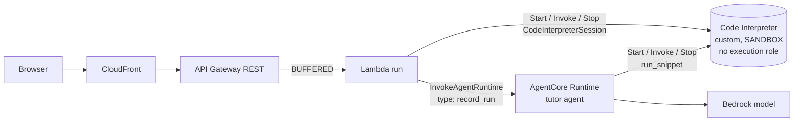
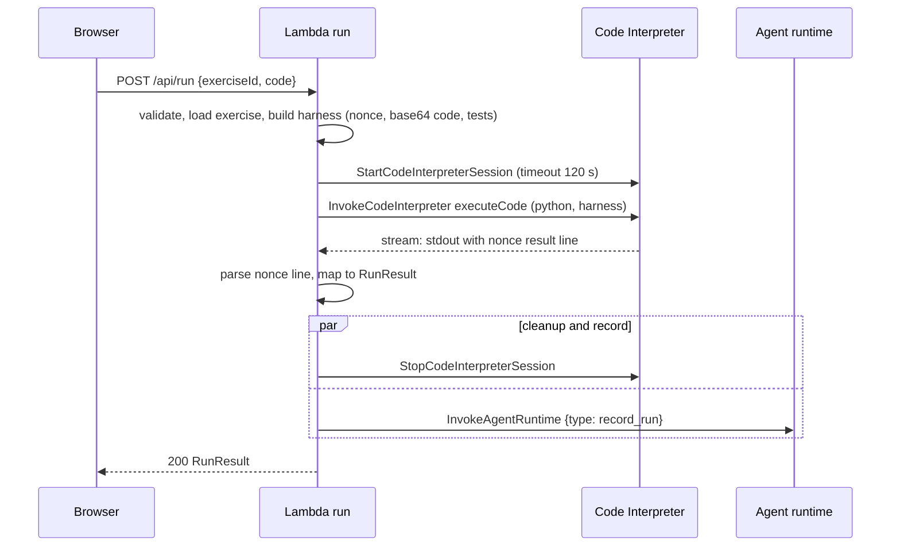

# Design Document

## Overview

Phase 2 replaces the simulated `/api/run` with real execution in an AgentCore Code Interpreter. The `run` Lambda builds a Python test harness from server content, sends it to a custom Code Interpreter session, reads a single nonce-tagged result line and maps it to the unchanged `RunResult` contract. The Lambda never executes student code. It only transports it.

The tutor agent gains two things: knowledge of the last run (so it can explain the student's actual error) and a small snippet tool that runs demonstrations in the same kind of sandbox.

Design goals:
- Keep the contract and the front end untouched.
- Make the isolation claims accurate. Sandbox mode is not "no network" in the strict sense, so the design states exactly what it protects and what it does not.
- Keep every run independent: one ephemeral session per run, always stopped.

## Architecture



Stacks and order are unchanged: `AgentStack` then `ApiStack` then `WebStack`. `AgentStack` now also owns the code interpreter and exports its id and ARN. `ApiStack` receives `codeInterpreterId` and `codeInterpreterArn` as props.

### Run sequence



If the wall clock (15 s) expires, the invoke is aborted, the session is stopped in `finally`, and the response is a failed `RunResult` with "La ejecución superó el tiempo máximo".

### Verified documentation and limitations

| Topic | Finding (current AWS documentation) | Consequence |
|---|---|---|
| Resource | `AWS::BedrockAgentCore::CodeInterpreterCustom` with `name`, `networkConfiguration.networkMode`, optional `executionRoleArn`, `certificates`, `description`, `tags`; exposed as L1 `CfnCodeInterpreterCustom` in `aws-cdk-lib` | L1 in `AgentStack` |
| System interpreter | `aws.codeinterpreter.v1`, pre-created, "most restrictive" defaults | Available, but the custom one makes network mode and tags explicit in IaC (D12) |
| Network modes | Sandbox ("limited external network access to Amazon services", S3 data operations), Public, VPC | Use Sandbox, see the security section |
| Sessions | `StartCodeInterpreterSession`: `sessionTimeoutSeconds` default 900, min 1, max 28,800; returns `sessionId`; `StopCodeInterpreterSession` ends it; multiple concurrent sessions per interpreter | Short TTL (120 s) plus explicit stop |
| Invocation | `InvokeCodeInterpreter` with `name` in `executeCode`, `executeCommand`, `readFiles`, `listFiles`, `removeFiles`, `writeFiles`, `startCommandExecution`, `getTask`, `stopTask`; `arguments.language`, `code`, `clearContext`; the response is a stream | `executeCode` only. The arguments have no timeout field, so timeouts are enforced inside the harness and by the Lambda wall clock |
| IAM actions | `Start`, `Invoke`, `Stop`, `Get`, `List` session actions and interpreter management actions; the documented example resource is `code-interpreter/*` | Only Start, Invoke and Stop are granted. The resource ARN shape of a custom interpreter is verified (task 9.1) |
| Pre-installed | Python, JavaScript and TypeScript runtimes with common libraries | Not needed for beginner exercises |

Unverified until implementation: the Python version of the interpreter (task 9.2), the shape of the `InvokeCodeInterpreter` response stream events (task 9.2), the ARN format of the custom interpreter (task 9.1), the naming pattern of the interpreter name (task 1.3), and session start latency (task 9.2).

### Security statement for Sandbox mode

What the design relies on:
- The interpreter has no execution role, so student code has no AWS credentials.
- The sandbox holds only the harness of the current run: no secrets, no reference solutions, no other student's data.
- Each run uses a new session that is stopped afterwards.
- Hard limits on time, memory and output.

What the documentation says about Sandbox mode: limited external network access to AWS services, including S3 data operations. Independent security researchers have published findings about outbound channels from Sandbox mode (DNS resolution and S3 access). So the statement in this project is: no public internet access intended and no credentials, not a proven absence of every outbound path. For a beginner tutor with no sensitive data in the sandbox this risk is acceptable for the POC. The production option is VPC mode with restricted egress, evaluated in Phase 5. The post must repeat this wording.

The in-harness socket block is a convenience defense in depth. It is not a control, because student code can undo it.

## Components and Interfaces

### API (`api/`)

New and changed files:

| File | Purpose |
|---|---|
| `lib/harness.ts` | `buildHarness({ code, tests, nonce })` returns the Python source; `parseHarnessOutput(text, nonce)` returns a validated `HarnessResult` or `null` |
| `lib/interpreter-client.ts` | Interface `InterpreterClient { run(source, opts): Promise<InterpreterOutput> }` with `CodeInterpreterClient` (SDK `StartCodeInterpreterSessionCommand`, `InvokeCodeInterpreterCommand`, `StopCodeInterpreterSessionCommand`) and a fake for tests |
| `lib/agent-client.ts` | Adds `recordRun(sessionId, payload)` to the Phase 1 interface |
| `lib/run-mapper.ts` | Maps `HarnessResult` and the exercise tests to `RunResult`, caps sizes |
| `handlers/run.ts` | Orchestrates: validate, harness, interpreter, parse, cleanup and record in parallel, respond |

`handlers/run.ts` flow:
1. Validate with `RunRequestSchema` (Phase 0 code, still 400/404/413).
2. If `RUN_BACKEND=mock`, return the Phase 0 simulated result.
3. Generate the nonce with `crypto.randomBytes(16).toString('hex')`.
4. `interpreter.run` with a 15 s `AbortSignal`.
5. `Promise.allSettled([stop session, recordRun with 5 s timeout])` inside `finally`.
6. Parse and map. Unparsable output yields the failed result described in requirement 7.2. Service errors yield 502.

Environment variables for `run`: `RUN_BACKEND`, `CODE_INTERPRETER_ID`, `AGENT_RUNTIME_ARN`, `SESSION_TIMEOUT_SECONDS` (default 120).

### Harness

The template is a TypeScript template literal. Placeholders are filled with the nonce and with base64 values only, so there is no string escaping surface. Structure of the generated Python (compatible with Python 3.10 and later; the interpreter version is recorded after task 9.2):

```python
import base64, builtins, contextlib, io, json, resource, signal, socket, sys, traceback

NONCE = "<nonce>"
CODE = base64.b64decode("<code_b64>").decode("utf-8")
TESTS = json.loads(base64.b64decode("<tests_b64>").decode("utf-8"))
FILE = "<tu_codigo>"
LIMIT_S, CAP = 3, 4000

def _cap(s): return s if len(s) <= CAP else s[:CAP] + "\n[salida recortada]"

def _on_alarm(signum, frame): raise TimeoutError("Tu código tardó demasiado (límite 3 s)")
signal.signal(signal.SIGALRM, _on_alarm)

# memory: limit relative to the current address space, to avoid breaking the interpreter process
vm = int(open("/proc/self/status").read().split("VmSize:")[1].split()[0]) * 1024
resource.setrlimit(resource.RLIMIT_AS, (vm + 256 * 1024 * 1024, resource.RLIM_INFINITY))

def _no_net(*a, **k): raise OSError("Sin acceso a la red en este entorno")
socket.socket.connect = _no_net            # best effort only
def _no_input(*a, **k): raise EOFError("input() no está disponible al ejecutar los tests")
builtins.input = _no_input

out, err = io.StringIO(), io.StringIO()
ns = {"__name__": "tu_codigo"}
load_error = None
try:
    signal.setitimer(signal.ITIMER_REAL, LIMIT_S)
    with contextlib.redirect_stdout(out), contextlib.redirect_stderr(err):
        exec(compile(CODE, FILE, "exec"), ns)
except BaseException as e:
    load_error = _format_student_error(e)      # keeps only frames from FILE, adds "Línea N"
finally:
    signal.setitimer(signal.ITIMER_REAL, 0)

results = []
for t in TESTS:
    if load_error:
        results.append({"passed": False, "message": "No se pudo cargar tu código"}); continue
    try:
        signal.setitimer(signal.ITIMER_REAL, LIMIT_S)
        with contextlib.redirect_stdout(out), contextlib.redirect_stderr(err):
            got = eval(t["call"], ns)
        ok = got == t["expected"]
        results.append({"passed": ok, "message": None if ok else
            f"Se esperaba {_short(t['expected'])} pero tu código devolvió {_short(got)}"})
    except TimeoutError as e:
        results.append({"passed": False, "message": str(e)})
    except MemoryError:
        results.append({"passed": False, "message": "Tu código usó demasiada memoria"})
    except BaseException as e:
        results.append({"passed": False, "message": f"Tu código lanzó {type(e).__name__}: {_short(str(e))}"})
    finally:
        signal.setitimer(signal.ITIMER_REAL, 0)

print(NONCE + json.dumps({"loadError": load_error, "tests": results,
      "stdout": _cap(out.getvalue()), "stderr": _cap(err.getvalue() + (load_error or ""))}),
      file=sys.__stdout__)
```

The sketch shows the intent. Helper functions (`_format_student_error`, `_short`) are part of the template. The Lambda ignores test names from the harness and uses the names from the content by index.

Known limits of the harness (documented, accepted):
- Student code shares the process, so a determined student can forge a result or read the embedded test data. This only affects their own result. The grader is not a security boundary.
- A student can catch `BaseException` in a loop and defeat the alarm. The Lambda wall clock and the session stop cover that case.
- The expected values appear in failure messages (D11).
- `input()` is unavailable, so exercises with interactive input are out of scope for automatic tests.

### Result mapping

`RunResult.tests[i].name` comes from `ejercicios.json`. `passed` is the conjunction of the test flags. `stdout` and `stderr` come from the harness and are capped again by the Lambda to 4000 characters each (8000 total). Control characters other than newline and tab are stripped before returning. The front end renders them as text nodes.

### Agent changes (`agent/`)

| Unit | Change |
|---|---|
| `protocol.py` | New payload `type: record_run` with `exerciseId`, `code`, `passed`, `tests[]`, `stdout`, `stderr`; validates types and sizes (code 20,000, outputs 8000) |
| `state.py` | `RunRecord`, `last_run` per exercise, `fail_streak` per (exercise, test name), `passed_exercises`, `pending_notices` |
| `tools.py` | `get_last_run(exercise_id)` and `run_snippet(code)` |
| `sandbox.py` | Thin wrapper over the `bedrock-agentcore` boto3 client: start session, `executeCode`, stop, with a 6 s read timeout and output caps |
| `prompts.py` | Rules for run context, untrusted data, error explanation and snippet use |
| `config.py` | `CODE_INTERPRETER_ID` (optional), `SNIPPET_TIMEOUT_SECONDS` (default 5) |

`record_run` flow: store the record (truncated), update streaks (a test that passes resets its streak, a failing test increments), set `passed` if all tests passed, and when any streak reaches 3 add a notice "El alumno falló 3 veces seguidas el test X: cambia de analogía o baja la dificultad" to `pending_notices`. The reply is `{"type":"ok"}` and the model is not called.

At the next `chat`, the per-request context block lists the exercise state: passed or not, and the pending notices, which are cleared after being added. `get_last_run` returns:

```
<datos_del_alumno untrusted="true">
codigo:
...
resultado: 2/3 tests aprobados
test "menor de edad": falló. Se esperaba 'menor' pero tu código devolvió 'adulto'
stderr:
...
</datos_del_alumno>
```

`run_snippet` rules: at most 1500 characters in, 5 s, 2000 characters out, 3 calls per turn (counter reset at the start of each chat request). It starts a session, runs `executeCode`, and stops the session in `finally`. If `CODE_INTERPRETER_ID` is not set it returns "No puedo ejecutar código ahora mismo". It receives neither tests nor solution. The Phase 1 solution guard still filters all tutor output.

Prompt-injection posture: run output and student code can contain text such as "ignora tus reglas". The prompt marks the block as data, the tool results are wrapped in the delimiters above, and the evaluation set adds three new adversarial conversations. The gate and the guard do not depend on the model following the prompt.

### Infrastructure

`AgentStack`:
- `CfnCodeInterpreterCustom` with `name` derived from the project name using only allowed characters (letters, digits and underscore; checked in task 1.3), `networkConfiguration: { networkMode: 'SANDBOX' }`, no `executionRoleArn`, tags.
- The runtime role gets `StartCodeInterpreterSession`, `InvokeCodeInterpreter` and `StopCodeInterpreterSession` on the interpreter ARN.
- The runtime gets `CODE_INTERPRETER_ID` as an environment variable.
- Outputs: `CodeInterpreterId`, `CodeInterpreterArn`.

`ApiStack`:
- Props: `codeInterpreterId`, `codeInterpreterArn`.
- `run` function: `RUN_BACKEND=interpreter`, memory 256 MB, timeout 25 s, bundles the AgentCore SDK.
- `run` policy: the three interpreter actions on the interpreter ARN, plus `bedrock-agentcore:InvokeAgentRuntime` on the runtime.
- `/api/run` method throttle: rate 5 per second, burst 10 (stage default stays at 50 and 100). Reserved concurrency is not used because new accounts may not have unreserved concurrency to spare.
- `/api/run` integration timeout: 29,000 ms.

Cost controls in this phase: short TTL, mandatory stop, method throttle, 20,000-character cap, one session per run. A budget alarm remains in Phase 5.

## Data Models

- `HarnessResult` (internal zod schema in `api/`): `{ loadError: string | null, tests: { passed: boolean, message: string | null }[], stdout: string, stderr: string }`, with the number of tests matching the exercise.
- `RunRecord` (agent): `{ code: str, passed: bool, tests: [{name, passed, message}], stdout: str, stderr: str, at: datetime }`.
- Public contract: unchanged `RunRequest` and `RunResult`.
- `ejercicios.json` `tests[].expected` must be JSON-comparable with Python equality (string, number, boolean, null, list). Floats are avoided in the content.

## Correctness Properties

*A property is a characteristic that must hold for every valid execution of the system. These properties drive the harness, handler and agent tests of this phase.*

### Property 1: Only the nonce line is trusted

*For any* student output, including lines that imitate the result format, the parser returns the result carried by the line prefixed with the run's nonce, and returns nothing when that line is absent.

**Validates: Requirements 3.6**

### Property 2: Student code is transported safely

*For any* student code string, including quotes, backslashes, triple quotes and non-ASCII text, the generated harness is valid Python, embeds the code only as base64, and decodes back to exactly the original string.

**Validates: Requirements 3.1**

### Property 3: The harness never contains the solution

*For any* exercise, the generated harness source contains none of the text of the reference solution.

**Validates: Requirements 3.2**

### Property 4: The result mirrors the exercise tests

*For any* harness outcome, `RunResult.tests` has one entry per exercise test in content order, and `passed` is true if and only if every entry passed.

**Validates: Requirements 2.7, 2.8**

### Property 5: Every started session is stopped exactly once

*For any* execution path (success, harness failure, malformed output, service error, timeout, abort), the session stop is attempted exactly once after the session start.

**Validates: Requirements 5.2**

### Property 6: Output size is bounded

*For any* student output size, the `stdout` and `stderr` returned to the client together never exceed 8000 characters.

**Validates: Requirements 4.6**

### Property 7: Reference solutions pass and starter code fails

*For every* exercise in the content, the reference solution passes all tests and the starter code fails at least one test.

**Validates: Requirements 14.1**

### Property 8: The failure streak notice is exact

*For any* sequence of runs of one exercise, the agent adds the adaptation notice if and only if the same test failed in three consecutive runs, a passing run resets that test streak, and the notice is cleared after it is used.

**Validates: Requirements 8.6**

### Property 9: Snippet execution respects its caps

*For any* snippet and output, the tool enforces the input, time and output limits, and never executes more than three snippets in one chat turn.

**Validates: Requirements 9.2**

### Property 10: Protection layers are unaffected by run records

*For any* run record stored in the session, the hint ladder, the solution gate and the solution guard produce the same decisions as without it.

**Validates: Requirements 10.4**

## Error Handling

| Condition | Result |
|---|---|
| Invalid body, unknown exercise, oversized body | 400, 404, 413 (unchanged) |
| Syntax error or exception at load | 200, all tests failed, "No se pudo cargar tu código", traceback in `stderr` |
| Wrong answer or exception inside a test | 200, that test failed with a Spanish message |
| Test or load timeout (3 s) | 200, failed test with the timeout message |
| Wall clock exceeded (15 s) | 200, all failed, "La ejecución superó el tiempo máximo"; session stopped |
| Result line missing or malformed | 200, all failed, cleaned service output in `stderr`; anomaly logged |
| Service throttled, denied or unavailable | 502 `internal_error`, generic Spanish message |
| Session stop fails | Logged only; the response is unaffected |
| `record_run` fails or exceeds 5 s | Logged only; the response is unaffected |

## Testing Strategy

| Layer | Tool | Coverage |
|---|---|---|
| Harness unit | Vitest | Generated source contains the nonce and base64 values and no solution text; special characters in student code do not alter the script; parser accepts only the nonce line and rejects forged and malformed lines |
| Harness execution | Vitest with local Python via `uv run` (skipped when unavailable) | Pass, wrong answer, syntax error, runtime exception, infinite loop, big allocation, `input()`, student print imitating the result line, reference solutions pass, starter code fails |
| Run handler | Vitest with a fake interpreter and agent client | Order of calls, stop in `finally` on every path, wall clock path, 502 mapping, mock switch, record failure ignored, contract shape, no solution in responses |
| Agent | `uv run pytest` | `record_run` validation and truncation, streak counting and notice clearing, `get_last_run` delimiters, `run_snippet` limits and unavailable mode with a fake sandbox, prompt phrases |
| Evaluation | `uv run pytest` and `-m live` | Phase 1 set plus the three new injection conversations; results recorded here |
| Infra | Jest assertions | Interpreter with `SANDBOX` and no role, scoped permissions on `run` and on the runtime role, env vars, throttle, timeouts, tags |
| Content verification | `npm run verify-content` | Against the real interpreter: every solution passes all tests and every starter code fails at least one |
| Manual E2E | Browser | Pass, fail, syntax error, exception, infinite loop, long output, ask the tutor about the last error, printed instruction trying to extract the solution |

Latency measurement: 10 runs from the browser with correct code; record median and maximum and the breakdown (session start, execution, stop, agent record).

## Open decisions and status

| # | Decision | Status |
|---|---|---|
| D10 | Session strategy | **Recommended: ephemeral session per run.** Stateless Lambdas cannot remember a session id, and a shared session would leak state between runs. Alternative: reuse sessions per student with an id stored in DynamoDB (Phase 3 may introduce it). Needs confirmation after the latency measurement |
| D11 | Failure messages show expected and obtained values | **Recommended: yes**, all tests are visible examples and the message teaches. Hidden tests are out of scope. Needs confirmation |
| D12 | Custom interpreter versus system `aws.codeinterpreter.v1` | **Recommended: custom with `SANDBOX`**, so the network mode, tags and permissions are visible in IaC and assertable in tests |
| D13 | How the agent reaches the interpreter | **Recommended: boto3 wrapper in `sandbox.py`**, for explicit timeouts and cleanup. The Python SDK helper `code_session` is an alternative to evaluate in task 7.1 |
| D14 | Revealing the reference solution after the student passes | **Unchanged in this phase**: the Phase 1 gate still applies. Revisit with Phase 3 progress |
| 5 | Region | Unchanged from Phase 1; the Code Interpreter availability in the region is confirmed in task 9.1 |

Known Phase 2 limitations: Sandbox mode is not a proof of zero egress; the harness shares a process with student code; `input()` is unavailable; sessions cost startup latency on every run; the API is still public and unauthenticated, so abuse control is the method throttle, the size caps and the short sessions.
