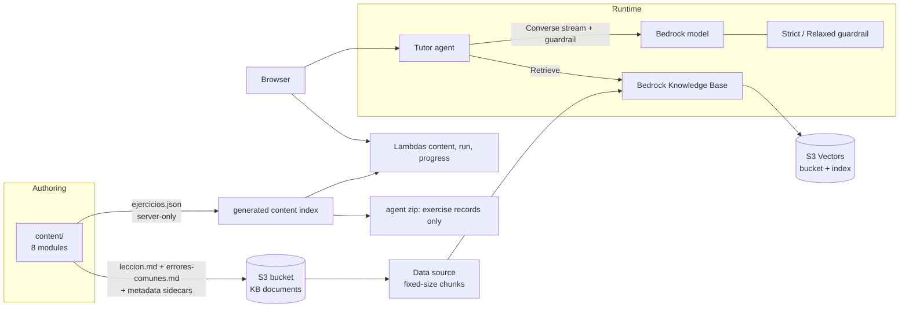
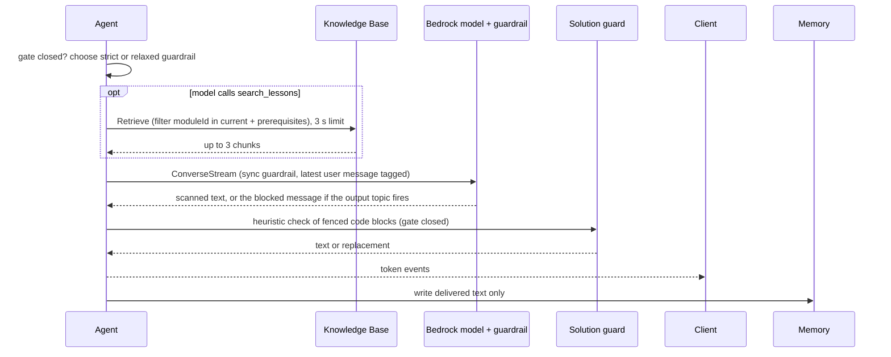

# Design Document

## Overview

Phase 4 turns the demo into a course. It adds the remaining seven modules, a retrieval layer so the tutor can explain with the course's own words, and a managed safety layer around the model.

The main design risk of the phase is a new leak path. Once lessons are embedded and searchable, anything in them can reach the model and the student. So the design separates content by trust level before it adds any retrieval:

- **Public content** (`leccion.md`, `errores-comunes.md`): goes to S3, the knowledge base and, through retrieval, the model context.
- **Server-only content** (`ejercicios.json`: tests, hints, reference solutions): bundled into Lambdas and the agent package, never uploaded to the knowledge base bucket, never sent to the browser.

On top of that, solution protection becomes five independent layers: the solution stays out of the model context, the deterministic gate, the prompt, a strict Bedrock guardrail with an output-side topic, and the heuristic code-block guard from Phase 1. Each layer can be switched off in evaluation to measure what the others catch.

The contract in `shared/` does not change. The `exerciseIdsFor` helper introduced in Phase 0 keeps deriving exercise ids, because the contract has no exercise-list endpoint.

## Architecture



Stacks and order: `ContentStack` (new) then `AgentStack` then `ApiStack` then `WebStack`. `AgentStack` receives `knowledgeBaseId`, `knowledgeBaseArn` and the guardrail ids, versions and ARNs as props. `ContentStack` owns the KB bucket, the vector store, the knowledge base, the data source, the ingestion trigger and both guardrails.

### Tutor reply path with all layers



### Verified documentation and limitations

| Topic | Finding (current AWS documentation) | Consequence |
|---|---|---|
| S3 Vectors as KB store | Supported. Semantic search only, no hybrid search. Up to 1 KB of custom metadata and 35 keys per vector. Hierarchical chunking with large token counts can exceed metadata size limits because parent-child data is stored as non-filterable metadata | Use fixed-size chunking (D22). Keep metadata to `moduleId` and `kind` |
| Vector resources | `AWS::S3Vectors::Index` has `Dimension` (1 to 4096), `DistanceMetric`, `DataType`, `MetadataConfiguration.NonFilterableMetadataKeys`; the KB storage config has an `S3VectorsConfiguration` | L1 constructs in `ContentStack`. Required non-filterable keys for Bedrock are confirmed in task 7.2 |
| Query latency | Documentation cites sub-second cold and about 100 ms warm queries | Measured in task 12.7 |
| KB sync | Ingestion jobs keep the data source and vectors in sync; deleting a data source offers Delete or Retain data deletion policies; one vector store per knowledge base is the recommended practice | One index dedicated to this KB |
| Guardrails and streaming | Default synchronous mode buffers and scans chunks before they are sent, with some latency and better accuracy. Asynchronous mode sends chunks immediately and may deliver content before it is flagged; it does not support masking of sensitive information | Synchronous mode (D24). Latency measured in task 12.7 |
| Guardrails integration | Three modes: model call configuration, guard content tagging in the request, and the standalone `ApplyGuardrail` API | Model call configuration through Strands. Input tagging for the prompt attack filter checked in task 8.4 |
| Strands | `BedrockModel` accepts guardrail id and version, a stream processing mode, and options to redact input and output | Exact parameter names and the "latest message only" option confirmed in task 8.4 |

Unverified until implementation: the required non-filterable metadata keys and metadata sidecar format (task 7.2), embedding model availability and dimension in the region and the KB configuration property names (task 7.3), the guardrail tier, Spanish support and any cross-region profile requirement (task 7.5), how the student message is tagged for the prompt attack filter in the Strands call (task 8.4), and the real latency added by synchronous guardrails (task 12.7).

## Components and Interfaces

### Curriculum

| Module | Topic | Main test kind | Example exercises |
|---|---|---|---|
| 01 | First steps: `print`, variables, types, `input` | Program (stdin and stdout) | Greeting with a name read from input; sum of two numbers; rectangle area from two inputs |
| 02 | Operators and strings | Function | Average of three numbers; reverse a word; build a sentence with an f-string |
| 03 | Conditionals | Function (exists) | Age classification; sign of a number; letter grade |
| 04 | Loops | Function | Sum from 1 to n; count vowels; multiples table as a list |
| 05 | Lists and dictionaries | Function | Largest value without `max`; word frequency dictionary; keep even numbers |
| 06 | Functions | Function | Default arguments; return several values; factorial |
| 07 | Files and errors | Function with `files` | Count lines of a file; safe integer conversion with `try/except`; sum numbers from a file ignoring bad lines |
| 08 | Mini project | Function with `files` | Grade book from a list of records; word counter over a text file |

The table is a plan. Final exercises are decided while authoring. Review checklist applied to every lesson and exercise (results recorded in the design when done):

1. Accuracy: every code example runs and prints what the lesson says.
2. Level: only concepts from the current and earlier modules.
3. Tone: patient, short sentences, one analogy per concept.
4. Spanish quality: neutral Latin American Spanish, consistent terms (variable, cadena, lista, diccionario).
5. Tests: each exercise has a boundary case and an error-prone case; tests do not depend on floating-point formatting.
6. Hints: level 1 asks a question, level 2 gives structure, level 3 shows almost the solution without the full code.
7. Leak control: lesson examples differ from exercise solutions.

### Extended server-side schema (`shared/` server-only subpath)

```ts
const FunctionTest = z.object({
  kind: z.literal('function').optional(),
  name: z.string().min(1),
  call: z.string().min(1),
  expected: JsonValue,
  files: FilesMap.optional(),
});
const ProgramTest = z.object({
  kind: z.literal('program'),
  name: z.string().min(1),
  stdin: z.array(z.string()),
  expectedStdout: z.string(),
  files: FilesMap.optional(),
});
```

`FilesMap` rejects absolute paths, `..` segments and values larger than 4 KB. `ExerciseRecordSchema` adds a refinement for unique test names and `prerequisites` that point to lower-numbered modules. The public `ExerciseSchema` and every API schema stay as they are. `structure.md` is updated with the new test shapes (D25).

```ts
export function exerciseIdsFor(module: Module): string[] {
  const n = /^modulo-(\d{2})-/.exec(module.id)?.[1];
  return Array.from({ length: module.exerciseCount }, (_, i) => `m${n}-e${String(i + 1).padStart(2, '0')}`);
}
```

A content test confirms that every module follows the convention, so the helper and the content cannot drift apart.

### Harness changes (`api/src/lib/harness.ts`)

The tests passed to the template now include `kind`, `stdin`, `expectedStdout` and `files`. Changes inside the Python template:

- `input()` becomes `_next_input()` over the test's `stdin` list. When the list is exhausted it raises `EOFError("El programa pidió más entrada de la esperada")`. When a program test reads input, the prompt text passed to `input(prompt)` is written to captured stdout, like a terminal would.
- Program test: a fresh namespace is created, the code is executed with stdout captured, and the output is compared after `rstrip` of each line and normalized newlines. A function test keeps the Phase 2 path (code loaded once, then `eval(call)`).
- Files: before each test the harness creates a temporary directory, writes the files, `chdir`s into it, and restores the working directory and removes the directory after the test.
- Load errors: a syntax error is still reported once and fails all tests. For a program test, a runtime exception inside the program is reported as that test's failure with the cleaned traceback line.
- Limits per test are unchanged (3 s, memory, output caps). The result line format is unchanged, so the parser and mapper do not change.

### Content index and API serving

`scripts/build-content-index.ts` reads `content/*/` and writes `api/src/generated/content-index.ts`, which statically imports each `ejercicios.json` (esbuild JSON loader) and each `leccion.md` (the `.md` text loader from Phase 0) and exports `modules: ModuleRecord[]`. The file is gitignored and produced by `npm run prepare:content`, which the `pretypecheck`, `pretest` and `prebuild` scripts call. `lib/content.ts` replaces its hard-coded import with the index. `errores-comunes.md` is not imported by the API. Public projection rules do not change.

### Knowledge base and ingestion (`ContentStack`)

- Bucket for KB documents: `BLOCK_ALL`, `enforceSSL`, `S3_MANAGED` encryption. A `BucketDeployment` publishes only the allowed files. The source is built by `scripts/build-kb-docs.ts` into `build/kb-docs/<moduleId>/{leccion.md,errores-comunes.md}` plus `<file>.metadata.json` sidecars (`{"metadataAttributes": {"moduleId": "...", "kind": "..."}}`), so the exclusion is an allowlist built from names, not a pattern that hides `ejercicios.json`. The deployment `prune` setting removes stale documents.
- Vector store: `CfnVectorBucket` and `CfnIndex` (dimension from context, `float32`, `cosine`, non-filterable keys as required by Bedrock).
- `CfnKnowledgeBase`: type `VECTOR`, embedding model ARN from `embeddingModelId`, storage type `S3_VECTORS` with the index ARN, and a service role (trust `bedrock.amazonaws.com` with source account and ARN conditions; permissions: read the bucket, invoke the embedding model, use the vector bucket and index).
- `CfnDataSource`: type `S3`, bucket ARN, `inclusionPrefixes` set, fixed-size chunking (`maxTokens` default 300, `overlapPercentage` default 20), data deletion policy `DELETE`.
- Ingestion trigger: an `AwsCustomResource` that calls `StartIngestionJob` on create and update, with `physicalResourceId` derived from the hash of the deployed documents, so it runs again only when content changes. Its role is limited to `bedrock:StartIngestionJob` and `bedrock:GetIngestionJob` on this knowledge base. The custom resource does not wait for completion. `scripts/ingest-kb.ts` starts a job and polls until it finishes, printing statistics, and task 12.2 uses it to confirm there are no failed documents.
- Outputs: `KnowledgeBaseId`, `KnowledgeBaseArn`, `DataSourceId`, `VectorBucketName`, `KbDocsBucketName`.

Embedding model (D22): **recommended Amazon Titan Text Embeddings V2 at 1024 dimensions**, because it handles Spanish and is available through Bedrock without extra subscription steps. Cohere multilingual embeddings are the alternative if retrieval quality in task 12.4 is below target. The final choice and dimension are recorded after the region check.

### Guardrails (`ContentStack`)

Two `CfnGuardrail` resources with a `CfnGuardrailVersion` each:

| Policy | Strict | Relaxed |
|---|---|---|
| Content filters (hate, insults, sexual, violence, misconduct) | Input and output, medium to high strength | Same |
| Prompt attack filter | Input, high | Same |
| Denied topic `FueraDeTema`: anything not related to learning programming | Input and output | Same |
| Denied topic `SolucionCompleta`: complete, ready-to-submit solution code for a course exercise | **Output only** | Absent |
| Word filter: managed profanity list | Input and output | Same |
| Sensitive information: email, phone, address, cloud credentials | Anonymize on output; block credentials on input | Same |
| Blocked messages | Spanish, short | Spanish, short |

The `SolucionCompleta` topic is output-only so that a student asking "dame la solución" is not blocked at the door. The tutor answers with a Socratic reply, and only a reply that contains a complete solution is replaced. Its Spanish blocked message reads along the lines of "Prefiero que lo construyas tú. ¿Seguimos con la siguiente pista?". The topic definition and examples are tuned in task 12.5. A fallback is documented: if the topic produces unacceptable false positives on legitimate small code examples, it is disabled and protection relies on the other four layers, with the residual risk recorded.

The relaxed guardrail exists because after the gate opens the tutor must be free to explain the full solution. The agent chooses the version per request from the deterministic gate state.

Tier (D24): the tier and Spanish support are checked in task 7.5. If the classic tier covers Spanish for the policies above it is used, since it needs no cross-region profile. Otherwise the standard tier is used with the required cross-region configuration and permissions.

### Agent changes (`agent/`)

| Unit | Change |
|---|---|
| `config.py` | `KNOWLEDGE_BASE_ID`, `GUARDRAIL_STRICT_ID/VERSION`, `GUARDRAIL_RELAXED_ID/VERSION`, `RETRIEVE_TIMEOUT_SECONDS` (3), `EVAL_DISABLE_LAYERS` (evaluation only, never set in CDK) |
| `kb.py` (new) | `LessonSearch.search(query, module_ids)` over `bedrock-agent-runtime` `Retrieve` with a `moduleId` filter, top 3, truncation to 800 and 2000 characters, 3 s limit, call cap of 2 per turn |
| `tools.py` | New tool `search_lessons(query, module_id?)`. The module filter defaults to the current exercise's module plus its prerequisites |
| `model.py` (new) | Builds the Bedrock model with the guardrail parameters and exposes `for_gate(open: bool)` that switches strict and relaxed per request |
| `app.py` | Chooses the guardrail from the gate, handles interventions, logs counts by policy type without content, keeps the solution guard after the guardrail |
| `prompts.py` | Rules for course material grounding and for referring to the module the student can review; removes the full common-mistakes block |
| `content.py` | Loads only exercise records; lessons and common-mistake files are no longer in the zip |
| `scripts/package-agent.*` | Copy only `ejercicios.json` files into the package |

`search_lessons` output format:

```
<material_del_curso module="modulo-04-bucles" kind="leccion">
...chunk text...
</material_del_curso>
```

Prompt rules: prefer the course material; mention the module title as the place to review; if nothing relevant is returned, explain from general knowledge without claiming it is in the course; never copy a code example from the material into a reply that answers an exercise.

Intervention handling: when the model stream reports a guardrail intervention, the delivered text is the configured blocked message. The agent records `guardrail_intervened` with the guardrail id, version and the policy type from the trace, and increments a per-session counter exposed in logs. The text sent to the client and to AgentCore Memory is the same delivered text.

Evaluation switches: `EVAL_DISABLE_LAYERS` accepts a comma list (`guardrail`, `guard`) and is read only when an `EVAL_MODE=1` variable is also set; a CDK assertion confirms neither variable is defined on the deployed runtime.

### Front end (`web/`)

| Unit | Change |
|---|---|
| `components/ModuleSelector` | Native `<select>` with a visible label listing the modules, plus the exercise count; keyboard operable |
| `hooks/useExercise` | Holds `moduleId` and `exerciseId`; on module change loads the lesson and the exercises from `exerciseIdsFor`; picks the first not-completed exercise |
| `hooks/useChat` | Keeps one transcript per exercise id in memory for the tab; cancels any active stream when the exercise changes |
| `components/ProgressPanel` | Overall count plus a per-module list with "n de m" text |
| Persistence | `sessionStorage` key for last module and exercise, restored on load if still valid |

Switching exercise while a reply is streaming aborts the request with the existing `AbortController`, shows the partial reply as interrupted in that exercise's transcript, and enables the input for the new exercise. The results panel needs no change: program tests produce the same `RunResult` shape.

### Infrastructure summary

- `bin/app.ts`: stacks `ContentStack` -> `AgentStack` -> `ApiStack` -> `WebStack`.
- `AgentStack` props: `knowledgeBaseId`, `knowledgeBaseArn`, `guardrails: { strict, relaxed }` (id, version, ARN).
- Runtime role additions: `bedrock:Retrieve` on the KB ARN; `bedrock:ApplyGuardrail` on the two guardrail ARNs; any extra permission the model call needs to use a guardrail, found in task 8.4.
- Context keys: `embeddingModelId`, `embeddingDimension`, `chunkMaxTokens`, `chunkOverlapPercent`, `guardrailTier`.
- All new resources are tagged `Project` and `Phase=4`.

## Data Models

- `ModuleRecord` (server): `{ id, title, lesson (markdown), exercises: ExerciseRecord[] }`, generated.
- KB document metadata: `{ moduleId, kind }`.
- `ExerciseRecord` tests: union of function and program tests, optional `files`.
- Public contract: unchanged.

## Correctness Properties

*A property is a characteristic that must hold for every valid execution of the system. These properties protect the content pipeline and the layered solution protection.*

### Property 1: The schema extension is backward compatible and safe

*For any* test without a `kind`, it is validated as a function test; *for any* test that mixes function and program fields, or declares an absolute path, a parent directory segment or a file over 4 KB, validation fails.

**Validates: Requirements 2.2, 2.4**

### Property 2: Server-only fields never reach clients or the knowledge base

*For any* module, no API response and no knowledge base document contains a `solution` field, hints, tests or the text of a reference solution.

**Validates: Requirements 5.6, 6.2, 6.6**

### Property 3: Only allowed files are uploaded for the knowledge base

*For any* content directory, the knowledge base build output contains only `leccion.md`, `errores-comunes.md` and their metadata sidecars, and never an `ejercicios.json`.

**Validates: Requirements 6.1, 6.2**

### Property 4: Every exercise is solvable and not already solved

*For every* exercise of the eight modules, the reference solution passes all tests and the starter code fails at least one test.

**Validates: Requirements 4.2**

### Property 5: Program tests compare normalized output

*For any* program and stdin lines, a program test passes if and only if the captured output equals `expectedStdout` after normalizing trailing whitespace and line endings, and a program that asks for more input than provided fails with the Spanish message.

**Validates: Requirements 3.1, 3.2**

### Property 6: Exercise ids follow the convention in all modules

*For any* of the eight modules, `exerciseIdsFor` returns exactly the ids present in its `ejercicios.json`.

**Validates: Requirements 1.4**

### Property 7: Lesson search stays within its limits

*For any* query and result set, the tool returns at most 3 chunks, each at most 800 characters and the total at most 2000 characters, only from the current module and its prerequisites when a module is known, and is called at most twice per chat turn.

**Validates: Requirements 9.2, 9.3, 16.4**

### Property 8: The guardrail version follows the gate

*For any* session state, the strict guardrail is used while the solution gate of the current exercise is closed and the relaxed guardrail is used when it is open.

**Validates: Requirements 11.1**

### Property 9: Protection layers are independent

*For any* single protection layer disabled in evaluation mode, the remaining layers make the same decisions as when all layers are enabled.

**Validates: Requirements 12.5**

### Property 10: Memory stores what the client received

*For any* reply, including a guardrail blocked message, the text written to AgentCore Memory equals the text delivered to the client.

**Validates: Requirements 11.4**

## Error Handling

| Condition | Result |
|---|---|
| Retrieval times out, fails or returns nothing | Tool returns a short note; the tutor continues without course material |
| `KNOWLEDGE_BASE_ID` unset | `search_lessons` disabled with a short message |
| Guardrail input intervention (off-topic, abuse, prompt attack) | Blocked message delivered as tutor text; logged by policy type |
| Guardrail output intervention (solution topic, filters) | Blocked message replaces the output; the solution guard still inspects what is delivered |
| Guardrail ids missing | Warning logged; agent runs without it; the heuristic guard stays active |
| Program test asks for more input | Failed test with the Spanish message; other tests still run |
| File test directory cannot be created | Failed test with a generic message; logged |
| Ingestion job reports failed documents | Verification task fails; the ids are listed from the job statistics |
| Stale or malformed content | `prepare:content` fails the build with the file and the schema error |

## Testing Strategy

| Layer | Tool | Coverage |
|---|---|---|
| `shared` | Vitest | Extended schema (valid, mixed kinds, bad paths, big files, duplicate names, prerequisites), `exerciseIdsFor` |
| Content | Vitest and `uv run pytest` | All modules validate; counts match; lesson length; leak lints (similarity against solutions, verbatim solution text) with the allowlist; ids follow the convention |
| Harness | Vitest with local Python via `uv run` | Program tests (match, mismatch, missing input, extra output, no input read), files, cwd restoration, all reference solutions pass and all starters fail |
| API | Vitest | Index generation and staleness, 8 modules served, totals in progress, recursive scan across modules for server-only fields |
| Agent | `uv run pytest` | Search tool with a fake client (filter composition, truncation, time limit, cap, disabled mode), guardrail selection by gate state, intervention handling and logging, solution guard after guardrail, evaluation switches independent, package contains no lessons |
| Infra | Jest assertions | KB type and storage, index settings, data source prefix and chunking, content asset without `ejercicios.json`, guardrail policies (output-only solution topic in strict only), scoped permissions, stack order, tags, no evaluation variables on the runtime |
| Front end | Vitest + React Testing Library | Module selector and keyboard use, selection restore, per-module progress, per-exercise transcripts, stream cancel on exercise change |
| Live evaluation | `uv run pytest -m live` | Legitimate questions (blocked count), off-topic, abuse, injection, personal data, solution-seeking by layer, retrieval hit rate |
| Manual E2E | Browser | Each module opens; function, program and file exercises complete; lesson question; off-topic question; direct solution request; module switch during streaming |

Targets recorded after the live runs: blocked legitimate questions equal to zero, retrieval expected module in the top 3 for at least 80% of 20 questions, time to first token under 3 s, and no solution-like block delivered before the gate opens.

## Open decisions and status

| # | Decision | Status |
|---|---|---|
| D21 | Where exercise records and lessons are served from | **Recommended: generated index bundled into Lambdas.** No request-time S3 reads, no new IAM, no cold-start cost, and solutions stay in server artifacts. A runtime S3 read would let content change without redeploy, which the POC does not need. Needs confirmation |
| D22 | Embedding model and chunking | **Recommended: Titan Text Embeddings V2, 1024 dimensions, fixed-size chunks of 300 tokens with 20% overlap.** Revisit with the retrieval evaluation |
| D23 | Ingestion trigger | **Recommended: custom resource on content hash change plus a manual script.** The resource does not wait for completion, so the script verifies it |
| D24 | Guardrail tier and mode | **Recommended: two guardrails (strict, relaxed), synchronous streaming mode.** Tier chosen in task 7.5 after checking Spanish support. Asynchronous mode is rejected because chunks can reach the student before being scanned |
| D25 | Extending `ejercicios.json` | **Recommended: additive optional fields** (`kind`, `stdin`, `expectedStdout`, `files`). Needed because modules 1 and 7 cannot be graded by return values alone |
| D26 | How the tutor uses the knowledge base | **Recommended: a tool the model calls** (not automatic injection on every turn), with a cap of 2 calls per turn. Honest note for the post: the whole course would fit in a prompt, so RAG here is a scaling and grounding choice, not a necessity |
| 5 | Region | Embedding model, S3 Vectors, Knowledge Bases and guardrail tier availability are confirmed in tasks 7.3, 7.5 and 12.1 |

Known Phase 4 limitations: S3 Vectors offers semantic search only; the similarity lint cannot catch an equivalent solution written differently; the solution output topic can misfire on legitimate examples and is tuned empirically; synchronous guardrails add latency; the API is still public and unauthenticated.
