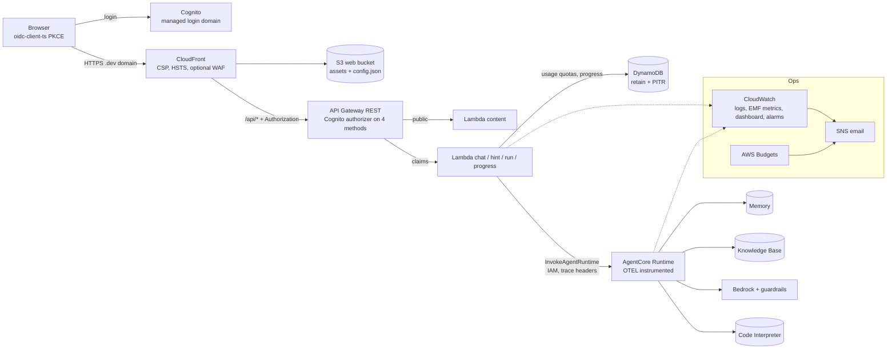
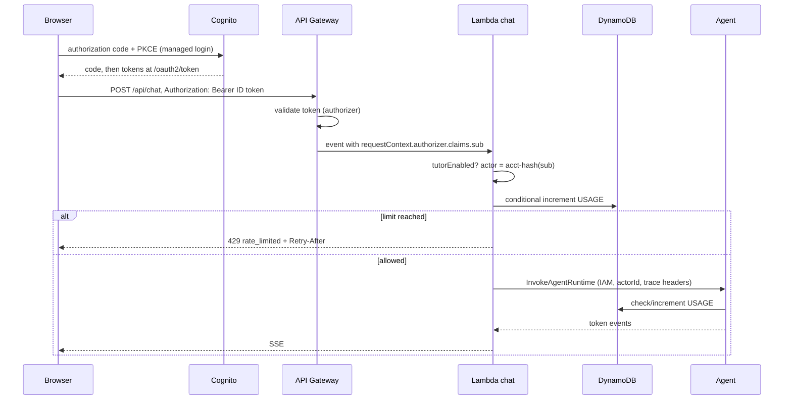

# Design Document

## Overview

Phase 5 closes the loop from "it works" to "it can be operated". Five concerns drive the design:

1. **Identity.** Cognito replaces the anonymous learner id. API Gateway validates the token, Lambdas trust only the authorizer claims, and every stored record is keyed by an account actor id derived from the Cognito `sub`. The agent is still reached only through IAM-authenticated Lambdas.
2. **Cost control.** Because every chat turn and every run costs money, limits move from "per session in memory" to "per account per day in DynamoDB", plus a deploy-time kill switch, an AWS Budget and alarms.
3. **Visibility.** Logs, custom metrics, traces through AgentCore, a dashboard and alarms that reach an inbox.
4. **Edge and data hygiene.** Custom `.dev` domain, certificate, strict headers (including a CSP, which requires bundling the editor locally), optional WAF, retained data with backups, and a deletion procedure.
5. **Reproducibility.** One command deploys everything, and a checklist verifies the five success criteria of the POC with evidence.

Contract policy: only three additive `ApiError` codes are introduced. All other schemas and all endpoint shapes stay as in Phase 4.

## Architecture



Stacks, in deployment order: `ContentStack`, `AgentStack`, `AuthStack`, `ApiStack`, `WebStack`, `OpsStack`.

| Stack | Phase 5 content |
|---|---|
| `AuthStack` | User pool, app client, login domain, Route 53 zone lookup and ACM certificate |
| `ApiStack` | Authorizer, protected and public methods, gateway responses, tracing, quota and kill-switch configuration |
| `WebStack` | Custom domain, DNS records, security headers, runtime `config.json`, optional WAF |
| `OpsStack` (new, D34) | SNS topic, dashboard, alarms, budget |
| `AgentStack` | OTEL entrypoint, retained table, optional VPC-mode interpreter |

`WebStack` depends on `AuthStack` for the certificate, the domain and the values written to `config.json`. `AuthStack` does not depend on `WebStack`: callback URLs are built from the `domainName` context value, so there is no cycle. Without a domain, the callback list contains only `http://localhost:5173/` and login works only locally (requirement 11.3).

### Request path with authentication



### Verified documentation and limitations

| Topic | Finding | Consequence |
|---|---|---|
| Transaction Search | A one-time setup per account and Region is required for AgentCore traces, through the API or the console; traces sent before it is enabled are not searchable | Task 7.2 checks whether CloudFormation can manage it; otherwise the README documents the step |
| AgentCore runtime metrics | Runtime metrics include invocations, throttles, system errors, user errors, latency, session count and active sessions, batched per minute | Dashboard and alarms use them; the exact namespace and dimensions are confirmed in task 8.2 |
| Bedrock metrics | The runtime endpoint publishes token and invocation metrics under the `AWS/Bedrock` namespace | Token alarm; the dimension for inference profiles is confirmed in task 8.3 |
| API Gateway streaming | Streaming works with Lambda proxy integrations on regional REST APIs; Phase 0 recorded the limitations | The authorizer runs before the integration; the combination is verified in task 13.2 |
| Direct invoke URL | `InvokeAgentRuntime` accepts trace headers (`X-Amzn-Trace-Id`, `traceparent`, `tracestate`, `baggage`) and a user id header | Lambdas propagate the trace context; the user id header is not used |
| OAuth and the AWS SDK | The service documents that OAuth-based inbound authorization to the runtime cannot use the AWS SDK and needs direct HTTPS | Supports the choice of IAM from the Lambdas (see Identity) |

Unverified until implementation: the managed login feature plan and the CDK properties for it (task 4.2), CloudFormation support for Transaction Search (task 7.2), the AgentCore metrics namespace (task 8.2), the Bedrock metric dimension for the chosen model or profile (task 8.3), the Cognito logout behavior with the OIDC library (task 9.1), and the WAF region constraint relative to the deployment region (task 6.4).

## Components and Interfaces

### Identity

- `api/src/lib/identity.ts`: `getAccount(event)` reads `event.requestContext.authorizer?.claims?.sub`; it returns `{ sub, email? }` or throws a 401 `ApiError`. `toAccountActorId(sub)` returns `"acct-" + sha256(sub).hex.slice(0, 32)`. The Phase 3 `learner-` derivation remains only for the local anonymous mode and tests.
- `deriveRuntimeSessionId(actorId, sessionId)` returns `"tutor-" + sha256(actorId + ":" + sessionId).hex.slice(0, 40)`. Phase 1 used only the client session id, so anyone who guessed another user's session id could reach that runtime session. Now the actor is part of the key.
- The JWT is never forwarded and never logged. Logs carry `actorIdHash` (8 characters) and the runtime session id.
- Local development: `LOCAL_DEV=1` enables a dev identity from header `X-Dev-Sub`. The deployed handlers do not read that header, and a test passes an event with the header and without `LOCAL_DEV` to prove it is ignored. The front end dev mode sends the header only when `import.meta.env.DEV` is true.

Agent identity decision (open decision 7 of `stacky.md`): **IAM from the Lambda roles.** AgentCore Identity with inbound JWT authorization was considered. It would require the caller to make a direct HTTPS request with a bearer token, because the AWS SDK path does not support OAuth inbound auth. That would move the call from the Lambdas to either the browser (violating "the front end never calls AgentCore") or to a Lambda that re-signs requests, with no gain. IAM keeps the Lambda as the single identity boundary, the agent trusts only IAM-authenticated callers, and the runtime is invocable only by the roles of `chat`, `hint` and `run`. If a future phase exposes the agent to other clients, inbound JWT becomes relevant.

### Authentication (`AuthStack`)

- `UserPool`: sign-in alias email, auto-verify email, self sign-up from context, password policy (length 10, lower, upper, digits), account recovery by email, deletion protection outside development.
- `UserPoolClient`: no secret, `authorizationCodeGrant`, scopes `openid email profile`, callback and logout URLs from context, token validity from context, `preventUserExistenceErrors`. The REST API authorizer accepts the **ID token** (no custom scopes), which is why the front end sends the ID token.
- `UserPoolDomain`: a Cognito prefix domain (D31), prefix derived from the project name plus a short hash of the account id (Cognito domain prefixes are unique per Region). A custom auth domain such as `auth.<domain>` is possible with another certificate and is listed as an option, not built. The managed login feature plan and CDK properties are confirmed in task 4.2.
- Domain: `HostedZone.fromLookup` with `domainName` and `hostedZoneName` context, and an ACM `Certificate` with DNS validation. CloudFront requires its certificate in `us-east-1`; with the recommended deployment region `us-east-1` it lives in the same stack. For another region the design requires cross-region references, recorded as unsupported in this phase unless needed.
- Outputs: `UserPoolId`, `UserPoolClientId`, `LoginDomain`, `CertificateArn`.

### API authorization (`ApiStack`)

- `CognitoUserPoolsAuthorizer` attached to `POST /api/chat`, `POST /api/hint`, `POST /api/run`, `GET /api/progress`. The three content GET methods have `AuthorizationType.NONE`. CORS preflight `OPTIONS` methods stay open.
- Gateway responses for `UNAUTHORIZED` (401), `ACCESS_DENIED` (403), `THROTTLED` (429) and `DEFAULT_5XX` with a body of the shape `{"code": "...", "message": "..."}` and the CORS headers.
- Lambda changes: all four protected handlers call `getAccount`; costly handlers call `usage.consume` and honor the kill switch; tracing `Active`; explicit log group retention (30 days by default); trace headers passed to the agent client.
- CloudFront `/api/*` origin request policy already forwards viewer headers except `Host`, which includes `Authorization`; a CDK assertion covers it.

### Usage quotas and kill switch

Quota item: `pk = LEARNER#<actorId>`, `sk = USAGE#<yyyymmdd>#<kind>` with `kind` in `chat`, `run`, `hint`, `tokens`, attributes `used` (number) and `ttl` (3 days).

```ts
interface UsageStore {
  // returns {allowed:true} or {allowed:false, retryAfterSeconds}
  consume(actorId: string, kind: 'chat' | 'run' | 'hint', limit: number): Promise<ConsumeResult>;
}
```

`consume` runs `UpdateItem ADD used :1` with `ConditionExpression: attribute_not_exists(used) OR used < :limit`. A `ConditionalCheckFailedException` means the limit was reached. `retryAfterSeconds` is the time to the next UTC midnight. Any other DynamoDB error fails closed (503 `unavailable`) and increments a `UsageStoreFailure` metric. Defaults: chat 150, run 300, hint 100 per day. In-flight overshoot is bounded by concurrency, because the condition is evaluated atomically per item.

The agent handles `tokens`: before each model call it reads `used`; if `used >= TOKEN_QUOTA` it emits the Spanish quota text and `done` without calling the model; after the call it adds the tokens reported by the usage metrics with an unconditional `ADD`. Overshoot is bounded by one reply. Default: 150,000 tokens per day. The Phase 1 per-session budget stays.

Kill switch: `TUTOR_ENABLED` environment variable on `chat`, `hint` and `run`. When it is `false` they return 503 `unavailable` ("El tutor está en mantenimiento...") before touching quotas, the agent or the interpreter. Changing it takes one `cdk deploy ApiStack` (about a minute or two for Lambda configuration updates; the real duration is recorded in task 13.6).

Contract note (D29): `ApiErrorSchema.code` gains `unauthorized`, `rate_limited` and `unavailable`. This is additive for the API. The front end ships in the same release and handles the new codes. An old cached client would show its generic error for an unknown code.

### Observability

Agent:
- `pyproject.toml` adds the AWS OpenTelemetry distribution (pinned). The runtime entrypoint changes to `['opentelemetry-instrument', 'main.py']`, which matches the form of the `fromS3` entrypoint array shown in the CDK documentation.
- Span attributes: runtime session id, actor id hash, exercise id, guardrail version, tool names. Never message text, code or tokens.
- Transaction Search: enabled once per account and Region; the CDK option is checked in task 7.2.

Lambdas: X-Ray active tracing on `chat`, `hint`, `run`, `progress`. The agent client passes `traceId`, `traceParent`, `traceState` and `baggage` from the Lambda's trace context to `InvokeAgentRuntime` so that one trace covers the browser request, the Lambda and the agent. A worked trace with times per stage goes into this document after task 13.5.

Custom metrics (EMF, namespace `TutorAgent`, helper `emit(name, value, unit, dimensions)` in TypeScript and Python, written as one JSON line to stdout):

| Metric | Dimensions | Source |
|---|---|---|
| `RunOutcome` | `Outcome` = passed, failed, timeout, error | `run` |
| `HintServed` | `Level` = 1, 2, 3 | agent |
| `SolutionRevealed` | none | agent |
| `GuardrailIntervention` | `Policy` = topic, contentFilter, promptAttack, word, pii | agent |
| `SolutionGuardReplacement` | none | agent |
| `MemoryFailure`, `RetrievalFailure` | `Operation` | agent |
| `QuotaRejected` | `Kind` = chat, run, hint, tokens | handlers, agent |
| `UsageStoreFailure` | none | handlers, agent |
| `TokensUsed` | none | agent |

No dimension holds a user, session or text value.

Logs: JSON lines, retention set explicitly on Lambda log groups; the AgentCore Runtime log group is managed by the service and its retention is recorded after deployment (task 13.5).

### Ops (`OpsStack`, D34)

- SNS topic with an email subscription from `alarmEmail`.
- Dashboard `tutor-agent-ops`: rows for API (requests, 4XX, 5XX, latency), Lambdas (errors, duration, throttles per function), AgentCore Runtime (invocations, system and user errors, throttles, latency, sessions), Bedrock (input and output tokens), DynamoDB (consumed capacity, throttles), custom metrics (run outcomes, hints, reveals, interventions, quota rejections).
- Alarms (all notify SNS, each with a description of the likely cause and the first check):

| Alarm | Signal | Default |
|---|---|---|
| ApiServerErrors | API Gateway 5XX sum | at least 5 in 5 minutes |
| ChatLambdaErrors | `chat` Lambda errors | at least 3 in 5 minutes |
| RunLambdaSlow | `run` p95 duration | above 20 seconds for 3 periods |
| AgentRuntimeErrors | AgentCore system errors or throttles | at least 1 for 3 periods |
| BedrockTokensDaily | input plus output tokens per day | above a threshold set after the load test |
| DynamoThrottles | throttled requests | at least 1 for 3 periods |
| GuardrailSpike | `GuardrailIntervention` sum | above a threshold per 15 minutes |
| UsageStoreFailures | `UsageStoreFailure` sum | at least 1 in 5 minutes |
| QuotaRejectionSpike | `QuotaRejected` sum | above a threshold per hour |
| WafBlocks (only if WAF) | blocked requests | above a threshold |

- Budget: `CfnBudget`, monthly cost, amount from context, notifications at 50%, 80% and 100% actual and 100% forecast to the same email. The `Project` tag filter works only after the cost allocation tags are activated in billing (a one-time manual step), so `budgetFilterByTag` is a context flag, default false until activation (task 8.4).

### Front end (`web/`)

| Unit | Responsibility |
|---|---|
| `public/config.json` (generated) | `{ region, userPoolId, clientId, loginDomain }`, written by `WebStack` from `AuthStack` outputs |
| `auth/config.ts` | Fetches `config.json` once at startup |
| `auth/AuthProvider.tsx` | Wraps `oidc-client-ts` `UserManager` (authority is the user pool issuer, PKCE, `sessionStorage` user store, `automaticSilentRenew`), exposes `user`, `login`, `logout`, `status`; handles the redirect callback and removes the code from the URL |
| `api/client.ts` | Single place that gets the ID token, adds `Authorization` to protected calls, retries once after a 401 with a silent renew, maps `unauthorized`, `rate_limited` and `unavailable` to typed errors |
| `components/Header` | Email and "Cerrar sesión" |
| `components/AuthGate` | Read-only mode when logged out: lessons, exercises and editor visible; chat, hints, run and progress replaced by a login prompt |
| `components/Notice` | Quota message with the reset time (from `Retry-After`) and the maintenance message |

Library: `oidc-client-ts` with an exact version, used because hand-rolling PKCE and token renewal is error-prone. Token storage trade-off (D35): tokens in `sessionStorage` survive reloads inside a tab and disappear when the tab closes; they are readable by any script running on the page, so the CSP and the removal of third-party scripts are part of the mitigation. Keeping tokens only in memory would remove that exposure but would force a login on every reload. Cognito's logout endpoint differs from the OIDC end-session convention, so the logout redirect is built explicitly with the login domain, client id and logout URL; confirmed in task 9.1.

Dev mode: when `config.json` is missing and `import.meta.env.DEV` is true, the client uses the dev identity header. A production build never includes that branch (dead-code eliminated, asserted by a test on the build output).

Monaco: install `monaco-editor`, call the loader configuration of `@monaco-editor/react` with the local instance, and register the editor worker with the Vite worker import so that no code comes from a CDN. The CSP therefore needs `worker-src 'self' blob:`.

### Edge security (`WebStack`)

Response headers policy on the default behavior and on `/api/*`:

| Header | Value (summary) |
|---|---|
| Content-Security-Policy | `default-src 'self'; script-src 'self'; style-src 'self' 'unsafe-inline'; img-src 'self' data:; font-src 'self' data:; worker-src 'self' blob:; connect-src 'self' https://<login domain>; frame-ancestors 'none'; base-uri 'self'; form-action 'self' https://<login domain>` |
| Strict-Transport-Security | `max-age=63072000; includeSubDomains` (preload optional) |
| X-Content-Type-Options | `nosniff` |
| Referrer-Policy | `strict-origin-when-cross-origin` |
| X-Frame-Options | `DENY` |

`style-src 'unsafe-inline'` is needed because the editor injects styles; the trade-off is recorded. `.dev` is on browser HSTS preload lists, so the site is HTTPS-only by construction; the redirect from HTTP is still configured.

Optional WAF (D30): `CfnWebACL` with scope `CLOUDFRONT`, default allow, one rate-based rule per IP (default 600 requests per 5 minutes, configurable), and one cheap managed rule group (the IP reputation list) selectable by context. Default off. Rationale: the costly endpoints already require a token, are limited per account, and are throttled at the stage; the unauthenticated surface is static files and three small content endpoints. WAF adds a fixed monthly charge plus a per-rule and per-request charge; the numbers are recorded in the README after checking current pricing. WAF CloudFront scope resources must be created in `us-east-1`, which matches the recommended deployment region.

### Data protection

- DynamoDB table: `RETAIN` and point-in-time recovery when `retainData` is true (default true outside development). Retained resources after `cdk destroy`: the table, the user pool and the Route 53 records are not removed by a plain destroy; the README lists them and the manual clean-up.
- `scripts/delete-account-data.ts <actorId|email> --confirm`: deletes DynamoDB items with partition key `LEARNER#<actor>` (progress, tutor state, usage), lists and deletes AgentCore Memory records under `/learners/<actor>/` and the actor's events, and with `--delete-user` removes the Cognito user. It prints counts per store. It needs operator credentials; the Lambdas get no delete permissions (D28).
- Retention table (final): progress and tutor state 365 days after last write; usage items 3 days; memory events per `memoryEventExpiryDays`; memory records per `memoryRecordExpiryDays`; Lambda log groups 30 days; CloudWatch dashboards and metrics per service defaults; AgentCore runtime logs per the service-managed group (recorded).

### Code Interpreter VPC-mode evaluation (D33)

A time-boxed spike, outside the main deployment path:
1. Create a VPC with isolated subnets, no NAT, no internet gateway route, and a security group without egress rules.
2. Create a second interpreter in VPC mode attached to that network.
3. Run the Phase 2 harness through it, then run snippets that attempt an HTTP request to a public host, a DNS lookup of a public name, and an S3 request.
4. Record: whether the harness works, session start latency versus Sandbox mode, behavior of each outbound attempt, and the monthly cost of the network resources (no NAT keeps it low; any interface endpoints add cost).
5. Decide: adopt (add the `interpreterNetworkMode` context flag and update the Phase 2 assertions) or accept the Phase 2 residual risk with the evidence.
6. Remove the spike resources unless adopted.

Expected insight to verify, not assume: inside a VPC the resolver still answers DNS queries, so DNS may remain a channel; the test shows what actually happens.

### Single-command deployment

`scripts/deploy.mjs` (Node, cross-platform) runs: `prepare:content`, tests (skippable with a flag for repeat deploys), front-end build, agent packaging (`package-agent.ps1` on Windows, `.sh` elsewhere), KB documents build, `cdk synth`, and `cdk deploy --all --outputs-file cdk-outputs.json --require-approval broadening`. It stops at the first failure and prints the site URL and main outputs. `npm run deploy` calls it. Manual one-time steps (documented, not automated): `cdk bootstrap`, Bedrock model access, domain registration and hosted zone, Transaction Search (if not CDK-managed), cost allocation tag activation, and confirming the alarm email subscription.

## Data Models

- Usage item: `{ pk, sk: "USAGE#yyyymmdd#kind", used, ttl }`.
- Account actor id: `acct-` plus 32 hexadecimal characters.
- `config.json`: `{ region, userPoolId, clientId, loginDomain }`, no secrets.
- `ApiError`: `{ code: invalid_request | not_found | payload_too_large | internal_error | unauthorized | rate_limited | unavailable, message }`.
- Context keys added: `domainName`, `hostedZoneName`, `selfSignUpEnabled`, token validity values, `tutorEnabled`, quota limits, `alarmEmail`, `monthlyBudgetUsd`, `budgetFilterByTag`, `enableWaf`, `wafRateLimit`, `retainData`, `logRetentionDays`, `interpreterNetworkMode`.

## Correctness Properties

*A property is a characteristic that must hold for every valid execution of the system. These properties cover authorization, identity isolation, cost limits and data hygiene.*

### Property 1: Authorization covers exactly the costly endpoints

*For any* method of the REST API, it has the Cognito authorizer if and only if it is one of `POST /api/chat`, `POST /api/hint`, `POST /api/run` or `GET /api/progress`, and no other write method is public.

**Validates: Requirements 2.1, 2.2, 17.6**

### Property 2: Identities are isolated

*For any* two distinct Cognito subjects, the account actor ids differ; *for any* client session id used by two actors, the derived runtime session ids differ; and no token appears in any log line or agent payload.

**Validates: Requirements 3.1, 3.3, 3.4**

### Property 3: Quotas are never exceeded

*For any* number of concurrent requests against a daily limit L for one actor and kind, at most L requests are accepted, and every rejected request receives a 429 `rate_limited` response.

**Validates: Requirements 5.1, 5.7**

### Property 4: Quota store failures fail closed

*For any* error from the usage store on `chat`, `hint` or `run`, the response is a 503 `unavailable` and no call is made to the agent or the interpreter.

**Validates: Requirements 5.10**

### Property 5: Retry-After points to the next UTC day

*For any* instant, the `Retry-After` value is between 1 and 86,400 seconds and the instant plus that value is the next UTC midnight (within one second).

**Validates: Requirements 5.4**

### Property 6: The kill switch dominates

*For any* request to `chat`, `hint` or `run` while `TUTOR_ENABLED` is false, the response is 503 `unavailable` regardless of quota or session state and with no downstream call; the content endpoints and `progress` are unaffected.

**Validates: Requirements 6.2, 6.3**

### Property 7: Metrics carry no identifying data

*For any* emitted metric line, its dimensions belong to the allowed list and no field contains a user id, a session id, student text or code.

**Validates: Requirements 8.2**

### Property 8: The development identity is inert when deployed

*For any* request carrying the development identity header while `LOCAL_DEV` is not set, the handlers ignore the header and treat the request as unauthenticated.

**Validates: Requirements 2.9**

### Property 9: The token quota stops model calls

*For any* actor whose daily token usage has reached the quota, the agent emits the quota message and `done` and makes no model call.

**Validates: Requirements 5.5**

### Property 10: Account deletion is complete

*For any* actor, after the deletion script runs with confirmation, no DynamoDB item with that actor's partition key and no memory record under that actor's namespaces remains.

**Validates: Requirements 13.3**

## Error Handling

| Condition | Status and code | Client behavior |
|---|---|---|
| Missing or invalid token | 401 `unauthorized` (gateway response or Lambda) | One silent renew, then login prompt, editor content kept |
| Token valid but forbidden | 403 `unauthorized` | Login prompt |
| Daily limit reached | 429 `rate_limited` + `Retry-After` | Spanish message with the reset time |
| Token quota reached in the agent | 200 stream with the quota text then `done` | Shown as tutor text |
| Kill switch on | 503 `unavailable` | Maintenance message; content and progress still work |
| Usage store failure | 503 `unavailable` | Retry message; alarm fires |
| Agent or interpreter failure | As in Phases 1 and 2 | Unchanged |
| Cognito unreachable | Login fails | Spanish message; read-only mode stays usable |

## Testing Strategy

| Layer | Tool | Coverage |
|---|---|---|
| API | Vitest | Claims extraction, 401 without claims, actor and runtime session derivation (different actors, same client session id give different runtime sessions), quota consumption (allowed, exceeded, concurrent with a fake conditional store), `Retry-After`, fail-closed behavior, kill switch order of checks, dev identity ignored when `LOCAL_DEV` is unset, generic errors |
| Agent | `uv run pytest` | Token quota check and increment, quota message without a model call, EMF line shape and absence of content, OTEL entrypoint configuration |
| Front end | Vitest + React Testing Library | Config loading, login redirect, callback cleanup, token attached only in `client.ts`, 401 renewal path, read-only mode, logout URL, quota and maintenance notices, dev mode absent from a production build, Monaco loads without network |
| Infra | Jest assertions | User pool and client settings, authorizer on exactly four methods, public methods, preflight open, gateway responses, domain and certificate wiring with and without a domain, CSP and headers, WAF both flags, dashboard widgets, alarms with SNS actions and descriptions, budget notifications, log retention, retained table with PITR, stack order, tags |
| Security | Commands | `npm audit`, `uv` dependency audit, secret scan, IAM review of synthesized policies |
| Load | Script | 10 simulated students for 10 minutes on a non-production deployment: errors, latency, throttling, quotas, cost |
| Manual E2E | Browser | Sign up with email verification, login, module with tutor, logout, expired session, quota exhaustion, maintenance mode, alarm email, deletion script, fresh `npm run deploy` |

## POC success criteria checklist (filled in task 16)

| Criterion | Evidence to record |
|---|---|
| A student completes a module end to end with the tutor | E2E run log for a full module with exercise results and tutor transcript summary |
| The tutor does not give the full solution before the hints are exhausted | Phase 1 and Phase 4 live evaluation results and the layered measurement |
| Student code runs in an isolated sandbox | Phase 2 design plus the VPC-mode evaluation outcome |
| The agent remembers progress across sessions | Phase 3 E2E and the post-login re-check |
| Everything deploys with CDK | Clean-checkout `npm run deploy` run following only the README |
| First token under 3 seconds | 20-request measurement |

## Open decisions and status

| # | Decision | Status |
|---|---|---|
| 7 | Authentication toward the agent | **Decided in this design: IAM from the Lambda roles.** Reasons above |
| D27 | Migrating anonymous Phase 3 and 4 data to accounts | **Recommended: no migration.** Production starts clean; the anonymous learner id is removed from protected flows. A migration would need an explicit claim endpoint that proves control of both the anonymous id and the account, copies progress and tutor state, and leaves memory records behind, since they cannot be re-keyed. Needs confirmation if demo data must be preserved |
| D28 | Data deletion | **Recommended: operator script now, self-service later.** A self-service endpoint would need delete permissions on the table and the memory for the Lambdas |
| D29 | `ApiError` codes | **Recommended: add `unauthorized`, `rate_limited`, `unavailable`.** The alternative of overloading `invalid_request` loses meaning for the client |
| D30 | WAF | **Recommended: off by default behind `enableWaf`.** Reasons above |
| D31 | Login experience | **Recommended: Cognito managed login on a prefix domain.** Less front-end code and no password handling in the app. Custom auth domain is an option |
| D32 | Front-end runtime configuration | **Recommended: `config.json` generated at deploy.** One build works for any environment and nothing environment-specific is baked in |
| D33 | Sandbox network mode | Open until the evaluation; default remains Sandbox mode with the residual risk stated |
| D34 | Extra `OpsStack` | **Recommended** because dashboards, alarms and budgets depend on every other stack. Requires adding it to `tech.md` (task 17) |
| D35 | Token storage | **Recommended: `sessionStorage` through the OIDC library with a strict CSP.** In-memory only is stricter but forces login on reload |
| 1 | Project name and domain | Open: the domain is a context value; `tutor-agent` stays the working name |
| 2 | Styling | CSS Modules, as proposed in Phase 0 |
| 3 | Progress persistence | DynamoDB plus Memory, as decided in Phase 3 |
| 4, 4b | Streaming and Lambdas per responsibility | As recorded in Phases 0 and 1 |
| 5 | Region | `us-east-1` recommended; confirmed by the deployments |
| 6 | OpenAPI from zod | Not generated; remains optional |

## Remaining known risks (to be completed with owners after the security review)

- Sandbox mode is not a proof of zero egress (mitigated by no credentials, short sessions, quotas; evaluated in the VPC spike).
- Public content endpoints can be scraped or used to generate cost; mitigated by the stage throttle, tiny responses and the optional WAF.
- Open self sign-up can be abused to create accounts; mitigated by email verification and per-account quotas, with the option to switch to invitation-only.
- Model behavior can still produce an unwanted answer; mitigated by five solution-protection layers and measured evaluation, not eliminated.
- Tokens in browser storage are exposed to XSS; mitigated by the CSP and by not loading third-party scripts.
- The solution similarity heuristics miss differently written equivalent solutions.
- Anonymous Phase 3 and 4 data is orphaned until it expires.
